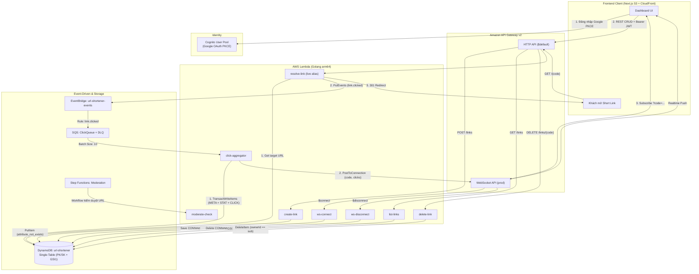

# Serverless URL Shortener with Realtime Analytics

Hệ thống rút gọn liên kết (URL Shortener) hiệu năng cao, mở rộng tự động với khả năng phân tích và cập nhật lượt click theo thời gian thực (Realtime Analytics) xây dựng trên nền tảng AWS Serverless, backend viết bằng Golang và giao diện người dùng Next.js Doodle UI.

---

## 1. Công Nghệ Sử Dụng (Tech Stack)

| Thành phần | Công nghệ / Dịch vụ | Vai trò trong hệ thống |
| --- | --- | --- |
| **Backend & Compute** | **Golang** (`provided.al2023`, kiến trúc `arm64`) | 8 hàm Lambda độc lập, biên dịch thành binary `bootstrap`: `create-link`, `resolve-link`, `list-links`, `delete-link`, `click-aggregator`, `ws-connect`, `ws-disconnect`, `moderate-check`. Khởi động cực nhanh (low cold start) và tiết kiệm chi phí. |
| **Cơ sở dữ liệu** | **Amazon DynamoDB** (Single-Table Design) | Chế độ On-Demand (`PAY_PER_REQUEST`). Quản lý metadata link, thống kê theo ngày, idempotency marker chống trùng lặp sự kiện và trạng thái kết nối WebSocket qua Sparse Index `GSI1` cùng `TTL`. |
| **Xử lý bất đồng bộ** | **Amazon EventBridge** + **Amazon SQS** | Custom Event Bus (`url-shortener-events`) phát sự kiện `link.clicked`, chuyển tiếp qua SQS `ClickQueue` và `ClickDLQ` (Dead-Letter Queue) để đảm bảo không mất dữ liệu. |
| **API Gateway** | **Amazon API Gateway v2** | - **HTTP API** (`$default` stage): Cung cấp các REST endpoint CRUD link và redirect link, tích hợp JWT Authorizer và Throttling.<br/>- **WebSocket API** (`prod` stage): Quản lý kết nối `$connect`/`$disconnect` và push sự kiện realtime. |
| **Xác thực người dùng** | **Amazon Cognito User Pool** + **Google OAuth** | Đăng nhập an toàn qua luồng OAuth 2.0 Authorization Code Flow kết hợp PKCE (Proof Key for Code Exchange), không lưu mật khẩu trên hệ thống. |
| **Điều phối nghiệp vụ** | **AWS Step Functions** | State Machine (`LinkModerationStateMachine`) tự động hóa quy trình kiểm duyệt an toàn URL độc lập. |
| **Giao diện người dùng** | **Next.js App Router** (TypeScript + Tailwind CSS) | Thiết kế theo phong cách Hand-Drawn / Doodle & Sketch UI. Cấu hình Static Export (`output: "export"`) thuần túy, an toàn và tối ưu tải trang. |
| **Hosting & CDN** | **Amazon S3** (Private) + **Amazon CloudFront** | S3 lưu trữ bản build tĩnh, CloudFront phân phối toàn cầu với Origin Access Control (OAC), bảo mật TLS và chống truy cập trực tiếp vào S3. |
| **Hạ tầng dưới dạng mã** | **Terraform** | Quản lý 100% tài nguyên AWS qua các module độc lập, quản lý remote state an toàn trên S3 và DynamoDB locking. |
| **Giám sát & Triển khai** | **AWS CloudWatch** + **AWS X-Ray** + **AWS CodeDeploy** | Tracing phân tán, CloudWatch Embedded Metric Format (EMF), Alarms tự động kích hoạt rollback khi deploy canary 10% trong 5 phút. |

---

## 2. Quy Trình Hoạt Động (Workflow)

### Sơ Đồ Kiến Trúc & Luồng Dữ Liệu



### Các Luồng Xử Lý Chính

1. **Tạo & Quản lý Link**:
   - Người dùng đăng nhập qua Google OAuth, nhận JWT token từ Cognito.
   - Frontend gửi yêu cầu `POST /links`, `GET /links`, hoặc `DELETE /links/{code}` kèm `Authorization: Bearer <token>`.
   - Lambda xác thực danh tính `claims.sub` và thao tác dữ liệu với DynamoDB: chống trùng mã bằng Base62 retry, phân trang danh sách bằng cursor, và chống can thiệp trái phép (IDOR) bằng `ConditionExpression`.
2. **Rút gọn & Redirect Link**:
   - Người dùng truy cập đường dẫn ngắn qua `GET /{code}`.
   - Lambda `resolve-link` truy vấn DynamoDB lấy target URL và phát sự kiện `link.clicked` lên EventBridge.
   - Trả ngay HTTP `301 Moved Permanently` điều hướng trình duyệt đến URL đích (thời gian phản hồi <50ms).
3. **Analytics Bất đồng bộ & Cập nhật Realtime**:
   - EventBridge định tuyến sự kiện `link.clicked` vào SQS `ClickQueue`.
   - Lambda `click-aggregator` tiêu thụ batch từ SQS và thực hiện `TransactWriteItems` trong DynamoDB:
     - Tăng bộ đếm tổng số click của link (`META`).
     - Tăng bộ đếm lượt click theo ngày (`STAT#YYYY-MM-DD`).
     - Ghi nhận marker chống xử lý lặp (`CLICK#eventId` với TTL 24h).
   - Sau khi ghi nhận thành công, Lambda truy vấn danh sách kết nối đang lắng nghe mã link và gửi bản tin WebSocket `{code, clicks}` qua API Gateway. Giao diện Dashboard tự động cập nhật số liệu tức thì mà không cần refresh.
4. **Kiểm duyệt Nội dung (Moderation)**:
   - AWS Step Functions thực thi workflow kiểm tra độ an toàn của đường dẫn thông qua task `moderate-check` và cập nhật cờ trạng thái tương ứng trong DynamoDB.

---

## 3. Cách Chạy (How to Run)

### Yêu Cầu Môi Trường (Prerequisites)

- **Go**: Phiên bản `>= 1.23`
- **Node.js**: Phiên bản `>= 20` và package manager **pnpm** (`>= 10`)
- **Terraform**: Phiên bản `>= 1.17`
- **AWS CLI**: Đã cài đặt và cấu hình credentials có đủ quyền hạn triển khai tài nguyên
- *(Tùy chọn)* **Docker**: Phục vụ chạy DynamoDB Local cho kiểm thử tích hợp

---

### Bước 1: Kiểm Thử Cục Bộ (Local Testing)

Kiểm tra toàn diện tất cả thành phần bằng lệnh:

```sh
make check
```

Hoặc chạy kiểm thử riêng biệt từng phần:

#### Backend (Go)
```sh
# Chạy Unit Tests có kiểm tra race condition
go -C backend test -race ./...

# Chạy phân tích tĩnh mã nguồn
go -C backend vet ./...
```

#### Frontend (Next.js)
```sh
cd frontend

# Cài đặt thư viện
pnpm install --frozen-lockfile

# Chạy server phát triển cục bộ (http://localhost:3000)
pnpm dev

# Chạy lint và kiểm tra TypeScript
pnpm lint
pnpm typecheck

# Chạy unit tests
pnpm test

# Kiểm tra xuất tĩnh (Static Export vào thư mục out/)
pnpm build
```

#### Kiểm Thử Tích Hợp với DynamoDB Local
```sh
# Khởi động container DynamoDB Local và chạy integration tests
make test-integration
```

---

### Bước 2: Biên Dịch Các Hàm Lambda (Go arm64)

Biên dịch 8 Lambda handler thành các binary thực thi Linux `arm64` có tên `bootstrap` và đóng gói thành file ZIP độc lập trong thư mục `build/`:

```sh
bash scripts/build-lambdas.sh
```

---

### Bước 3: Triển Khai Hạ Tầng AWS (Terraform)

#### 3.1 Khởi tạo Bootstrap (State Bucket, DynamoDB Lock & IAM)
```sh
cd infrastructure/terraform/bootstrap
terraform init
terraform apply
```

#### 3.2 Triển khai Môi Trường Dev
```sh
cd ../environments/dev

# Cấu hình backend remote state
terraform init -backend-config=backend.hcl

# Áp dụng cấu hình hạ tầng
terraform apply
```
> **Lưu ý:** Sao chép file mẫu `terraform.tfvars.example` thành `terraform.tfvars` và điền cấu hình Google OAuth Client ID/Secret trước khi chạy `apply`.

---

### Bước 4: Phát Hành Giao Diện Frontend (S3 + CloudFront)

Sau khi hạ tầng đã triển khai thành công, chạy script tự động lấy thông tin output API từ Terraform, build giao diện và đồng bộ lên S3/CloudFront:

```sh
bash scripts/publish-frontend.sh
```

---

## 4. Tài Liệu Tham Khảo Kỹ Thuật

- Chi tiết hợp đồng API HTTP/WebSocket, cấu trúc Single-Table DynamoDB và schema sự kiện: [`docs/architecture-and-contracts.md`](docs/architecture-and-contracts.md)
