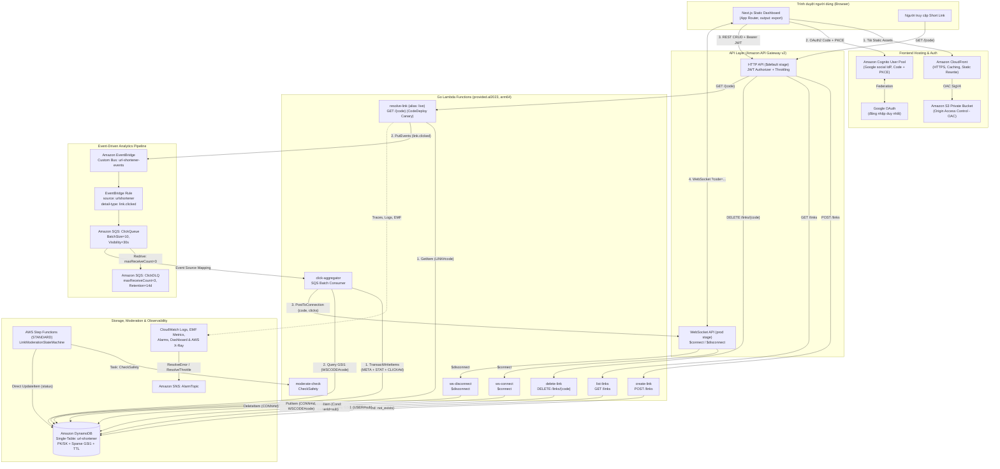
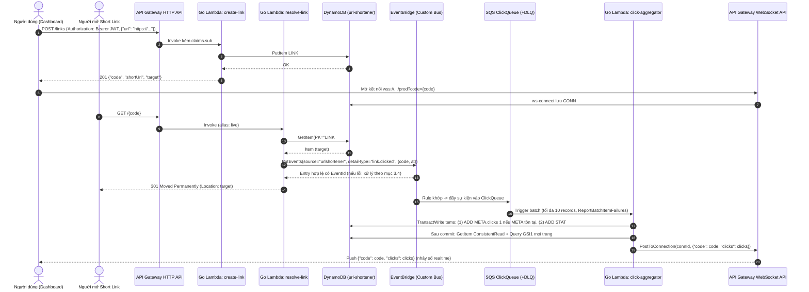
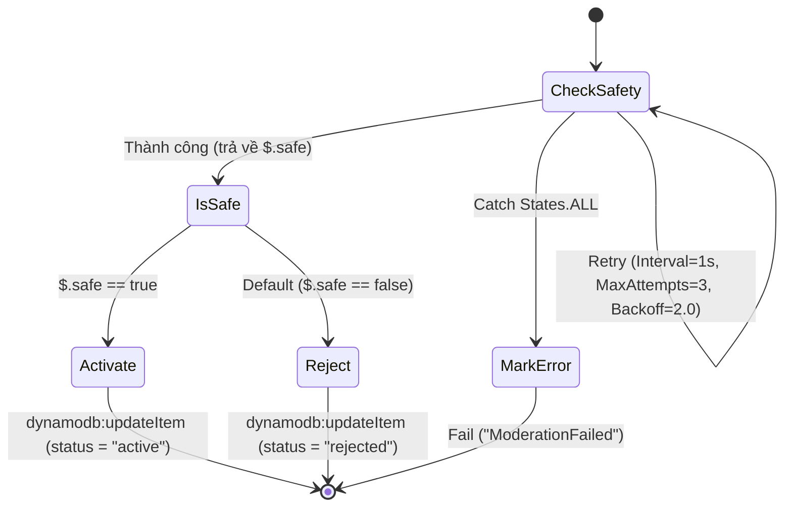

# Kiến Trúc Hệ Thống, Hợp Đồng API & Thiết Kế Dữ Liệu (Architecture & Contracts)

Tài liệu này định nghĩa đặc tả kỹ thuật chuẩn cho hệ thống **Serverless URL Shortener with Realtime Analytics** viết bằng **Golang**, quản lý hạ tầng bằng **Terraform**, và giao diện **Next.js Static Export** triển khai trên **Amazon S3 (Private) + CloudFront OAC**.

Chốt ngày 2026-10-27 từ audit nguồn ngày 2026-10-26. Đây là hành vi đích cần triển khai và kiểm thử, chưa phải bằng chứng ứng dụng đã chạy. Các mục lỗi dưới đây là nguồn đặc tả chính cho audit và kế hoạch.

---

## 1. Sơ Đồ Kiến Trúc Tổng Thể (Mermaid)



---

## 2. Luồng Xử Lý Chi Tiết (Sequence Diagram)



---

## 3. Hợp Đồng Backend HTTP API (API Contract)

Hệ thống giữ nguyên 4 route HTTP cốt lõi trên stage `$default` của API Gateway HTTP API:

| Method | Endpoint | Authentication | Lambda Handler | Mô tả |
| --- | --- | --- | --- | --- |
| `POST` | `/links` | Cognito JWT Authorizer | `create-link` | Tạo link rút gọn mới thuộc sở hữu của `claims.sub` |
| `GET` | `/links` | Cognito JWT Authorizer | `list-links` | Liệt kê danh sách link của `claims.sub` (mới nhất trước) |
| `DELETE` | `/links/{code}` | Cognito JWT Authorizer | `delete-link` | Xóa link nếu tồn tại và thuộc sở hữu của `claims.sub` |
| `GET` | `/{code}` | Public (Không cần token) | `resolve-link` | Phát sự kiện `link.clicked` và trả `301` kèm header `Location` |

### 3.1 `POST /links`
- **Headers:** `Authorization: Bearer <Cognito_JWT>`, `Content-Type: application/json`
- **Request Body:**
  ```json
  {
    "url": "https://kubernetes.io/docs/home/"
  }
  ```
- **Quy tắc xử lý:**
  1. Lấy `ownerId` từ `event.RequestContext.Authorizer.JWT.Claims["sub"]`. Nếu rỗng trả `401 {"error": "thieu danh tinh nguoi dung"}`.
  2. Parse JSON body. Nếu lỗi cú pháp trả `400 {"error": "body khong phai JSON hop le"}`.
  3. Body phải là object có `url` kiểu string; từ chối `null`, thiếu trường, number/array/object. Chuẩn hóa và kiểm tra URL: chỉ chấp nhận scheme `http` hoặc `https` có host hợp lệ. Nếu sai trả `400 {"error": "thieu hoac sai truong 'url' (chi nhan http/https)"}`.
  4. Sinh mã Base62 dài 7 ký tự (`0-9A-Za-z`) từ nguồn ngẫu nhiên mật mã (`crypto/rand`).
  5. Ghi vào DynamoDB với `ConditionExpression: "attribute_not_exists(PK)"`. Nếu gặp `ConditionalCheckFailedException`, sinh mã khác với tối đa **5 lần ghi tổng cộng, gồm lần đầu**. Sau 5 lần vẫn trùng trả `500 {"error": "khong sinh duoc ma duy nhat, thu lai"}`. Đây là chống collision, không phải idempotency của `POST /links`.
  6. Tạo `shortUrl` từ `PUBLIC_REDIRECT_BASE_URL` (hoặc `https://<domainName>`) + `/${code}`.
- **Response `201 Created` (`application/json`):**
  ```json
  {
    "code": "86Fgqtq",
    "shortUrl": "https://<api-id>.execute-api.ap-southeast-1.amazonaws.com/86Fgqtq",
    "target": "https://kubernetes.io/docs/home/"
  }
  ```

### 3.2 `GET /links`
- **Headers:** `Authorization: Bearer <Cognito_JWT>`
- **Quy tắc xử lý:**
  1. Lấy `ownerId` từ `claims["sub"]`. Nếu thiếu trả `401 {"error": "thieu danh tinh nguoi dung"}`.
  2. Thực hiện `Query` trên index `GSI1` với `KeyConditionExpression: "GSI1PK = :u"`, `:u = "USER#" + ownerId`, `ScanIndexForward = false` (sắp xếp theo `GSI1SK = LINK#<createdAt>` giảm dần). Tuyệt đối không dùng `Scan`.
  3. Tiếp tục `ExclusiveStartKey = LastEvaluatedKey` đến hết trang rồi trả một mảng `links` như cũ; không thêm endpoint hay schema phân trang. GSI chỉ có eventual consistency nên link vừa tạo/xóa hoặc count mới có thể chưa hiện ngay.
- **Response `200 OK` (`application/json`):**
  ```json
  {
    "links": [
      {
        "code": "86Fgqtq",
        "target": "https://kubernetes.io/docs/home/",
        "clicks": 4,
        "createdAt": "2026-10-26T08:00:00.000Z"
      }
    ]
  }
  ```

### 3.3 `DELETE /links/{code}`
- **Headers:** `Authorization: Bearer <Cognito_JWT>`
- **Quy tắc xử lý:**
  1. Lấy `ownerId` từ `claims["sub"]` và `code` từ path parameter; thiếu danh tính trả `401`.
  2. Thực hiện `DeleteItem` trên `PK = "LINK#" + code, SK = "META"` với `ConditionExpression: "attribute_exists(PK) AND ownerId = :me"`, `:me = ownerId`.
  3. Nếu gặp `ConditionalCheckFailedException` (link không tồn tại **hoặc** thuộc người dùng khác), đều trả `404 Not Found` với cùng một thông báo để chống dò quét IDOR:
     ```json
     { "error": "link khong ton tai hoac khong thuoc ve ban" }
     ```
  4. Chỉ xóa `META`; không xóa `STAT` hoặc marker `CLICK`. Click đến muộn được xử lý theo mục 5.2, không tái tạo metadata.
- **Response `200 OK` (`application/json`):**
  ```json
  {
    "deleted": "86Fgqtq"
  }
  ```

### 3.4 `GET /{code}`
- **Authentication:** Public
- **Quy tắc xử lý:**
  1. Thực hiện `GetItem` với `PK = "LINK#" + code, SK = "META"`.
  2. Nếu không tìm thấy item: ghi log cảnh báo `"link not found"`, phát CloudWatch EMF metric `LinkNotFound = 1` (namespace `UrlShortener`), trả `404 Not Found` (`text/plain`: `"khong tim thay link"`).
  3. Nếu tìm thấy: phát sự kiện lên EventBridge custom bus (`EVENT_BUS`):
     - `Source`: `"urlshortener"`
     - `DetailType`: `"link.clicked"`
     - `Detail`: `{"code": "<code_value>", "at": "<RFC3339_UTC_timestamp>"}`
  4. Kiểm tra cả `FailedEntryCount` và từng `Entries`: chỉ ghi log `"link resolved"`, phát `LinkResolved = 1` và trả `301` với `Location: <target>`, body rỗng khi response có đúng entry thành công, `EventId` không rỗng và không có `ErrorCode`. HTTP 200 của `PutEvents` chưa đủ để kết luận thành công.
  5. Với entry lỗi `InternalFailure` hoặc `ThrottlingException`, thử lại tối đa **3 lần gọi tổng cộng**, backoff có jitter và deadline nằm dưới timeout Lambda 5s. Giới hạn cả transport retries của SDK trong cùng deadline; không để retry lồng nhau kéo dài vô hạn. Lỗi không retryable, response thiếu/sai hoặc hết lượt: structured log + metric `ClickPublishFailed`, trả error từ Lambda để API trả 5xx, không redirect.

Theo [AWS PutEvents](https://docs.aws.amazon.com/eventbridge/latest/userguide/eb-putevents.html), bus không tồn tại có thể làm sự kiện bị drop dù HTTP 200 và không tăng failed count. Terraform phải truyền bus thật, cấp `events:PutEvents` trên đúng bus ARN và E2E kiểm chứng rule → SQS. Timeout mạng có kết quả bất định: lần gọi trước có thể đã publish; publish lại có EventBridge `id` mới nên không hứa exactly-once, không thêm outbox hay đổi schema. `LinkResolved` đo publish được chấp nhận, không chứng minh click đã commit; cache 301 của trình duyệt cũng khiến nhiều lần mở không tới backend.

### 3.5 Quy Tắc Tách Biệt Domain (CloudFront vs. API Gateway)
- Giao diện Next.js chạy trên domain mặc định của **CloudFront** (`https://<dist>.cloudfront.net`).
- Các API và đường dẫn rút gọn `GET /{code}` chạy trực tiếp trên domain mặc định của **API Gateway HTTP API** (`https://<api-id>.execute-api.<region>.amazonaws.com`).
- Nhờ đó, `GET /{code}` ở gốc API Gateway không bao giờ xung đột với các route tĩnh của Next.js (`/`, `/login`, `/auth/callback`, `/dashboard`, `/links`), và `shortUrl` luôn trỏ chính xác về domain công khai của API Gateway.

---

## 4. Thiết Kế DynamoDB Single-Table & Giải Thích Access Patterns

### 4.1 Cấu Hình Bảng
- **Tên bảng mặc định:** `url-shortener` (cho phép cấu hình qua biến Terraform)
- **Billing mode:** `PAY_PER_REQUEST` (On-Demand)
- **Primary Key:** Partition Key `PK` (`S`), Sort Key `SK` (`S`)
- **Global Secondary Index (`GSI1`):** Partition Key `GSI1PK` (`S`), Sort Key `GSI1SK` (`S`), `ProjectionType: ALL`
- **Time To Live (TTL):** Bật trên thuộc tính `ttl` (Unix epoch seconds)

### 4.2 Bảng Thiết Kế 4 Thực Thể (Entities) & Đặc Tính Sparse Index

`createdAt` dùng UTC ISO8601 cố định 3 chữ số milliseconds như JavaScript `toISOString` (`2006-01-02T15:04:05.000Z` trong Go), không dùng RFC3339Nano có độ dài biến thiên vì GSI sắp xếp theo chuỗi. Test thứ tự trong cùng giây và chuẩn hóa timezone về UTC.

| Thực thể | `PK` | `SK` | `GSI1PK` | `GSI1SK` | Thuộc tính dữ liệu | `ttl` | Có mặt trong `GSI1`? |
| --- | --- | --- | --- | --- | --- | --- | --- |
| **Link Metadata** | `LINK#{code}` | `META` | `USER#{ownerId}` | `LINK#{createdAt}` | `target` (S), `ownerId` (S), `createdAt` (S), `clicks` (N), `status` (S, tùy chọn) | Không | **Có** (phục vụ tra cứu link theo chủ sở hữu) |
| **Daily Analytics** | `LINK#{code}` | `STAT#{YYYY-MM-DD}` | *(Không đặt)* | *(Không đặt)* | `count` (N) | Không | **Không** (Sparse: tự động bị loại khỏi `GSI1`) |
| **Idempotency Marker** | `CLICK#{eventId}` | `CLICK` | *(Không đặt)* | *(Không đặt)* | *(Không có)* | `now + 86400` (+24h) | **Không** (Sparse: tự động bị loại khỏi `GSI1`) |
| **WebSocket Connection** | `CONN#{connectionId}` | `META` | `WSCODE#{code}` | `CONN#{connectionId}` | `code` (S) | `now + 7200` (+2h) | **Có** (phục vụ tìm các kết nối đang nghe `code`) |

### 4.3 Chi Tiết Từng Access Pattern & Thao Tác DynamoDB

| # | Nghiệp vụ | Thao tác DynamoDB | Bảng / Index | Biểu thức Khóa / Điều kiện / Cập nhật | Giải thích kỹ thuật |
| --- | --- | --- | --- | --- | --- |
| **AP1** | Tạo link mới | `PutItem` | Bảng chính | `PK = LINK#{code}`, `SK = META`<br/>`ConditionExpression: attribute_not_exists(PK)` | Đảm bảo tính duy nhất của mã ngắn ngay ở tầng lưu trữ; nếu trùng mã sẽ ném `ConditionalCheckFailedException` để Lambda sinh mã khác (tối đa 5 lần). |
| **AP2** | Redirect & lấy URL đích | `GetItem` | Bảng chính | `PK = LINK#{code}`, `SK = META` | Truy xuất điểm (`O(1)`) độ trễ vài mili-giây theo khóa chính. |
| **AP3** | Liệt kê link của người dùng | `Query` | Index `GSI1` | `KeyConditionExpression: GSI1PK = :u` (`:u = USER#{ownerId}`), `ScanIndexForward = false` | Đọc hết các trang `LastEvaluatedKey`, giữ thứ tự mới nhất trước và JSON `links`; GSI eventual consistency. |
| **AP4** | Xóa link của người dùng | `DeleteItem` | Bảng chính | `PK = LINK#{code}`, `SK = META`<br/>`ConditionExpression: attribute_exists(PK) AND ownerId = :me` | Kiểm tra quyền sở hữu và xóa trong một thao tác nguyên tử duy nhất, triệt tiêu lỗ hổng IDOR và race condition giữa bước kiểm tra và bước xóa. |
| **AP5** | Đếm click nguyên tử & chống trùng hữu hạn | `TransactWriteItems` | Bảng chính | 1. `Update`: `PK=LINK#{code}, SK=META` → `ADD clicks :one`, condition `attribute_exists(PK)`<br/>2. `Update`: `PK=LINK#{code}, SK=STAT#{YYYY-MM-DD}` → `ADD #c :one`<br/>3. `Put`: `PK=CLICK#{eventId}, SK=CLICK, ttl=+24h`, condition `attribute_not_exists(PK)` | Cả 3 cùng thành công hoặc cùng hủy. Dedupe chỉ khi marker còn tồn tại; phân loại lỗi theo mục 5.2. |
| **AP6** | Lưu kết nối WebSocket khi `$connect` | `PutItem` | Bảng chính | `PK = CONN#{connectionId}`, `SK = META`, `GSI1PK = WSCODE#{code}`, `GSI1SK = CONN#{connectionId}`, `ttl = +2h` | Lưu theo `CONN#{connectionId}` để xóa nhanh khi `$disconnect`, đồng thời chiếu vào `GSI1` dưới phân vùng `WSCODE#{code}`. |
| **AP7** | Xóa kết nối khi `$disconnect` hoặc gặp `410 Gone` | `DeleteItem` | Bảng chính | `PK = CONN#{connectionId}`, `SK = META` | Trong sự kiện `$disconnect`, API Gateway chỉ cung cấp `connectionId` (không còn query string `code`); nhờ `PK = CONN#{connectionId}`, ta xóa trực tiếp bằng `DeleteItem` mà không cần biết `code`. |
| **AP8** | Tìm các kết nối đang theo dõi một mã link | `Query` | Index `GSI1` | `KeyConditionExpression: GSI1PK = :p` (`:p = WSCODE#{code}`) | Trả về danh sách mọi `connectionId` đang mở cho mã `code` để gọi `PostToConnection`. |
| **AP9** | Cập nhật trạng thái kiểm duyệt link | `UpdateItem` | Bảng chính (Step Functions SDK integration) | `PK = LINK#{code}`, `SK = META`<br/>`UpdateExpression: SET #s = :active` (hoặc `:rejected`) | Step Functions gọi trực tiếp `arn:aws:states:::dynamodb:updateItem` mà không cần viết thêm Lambda phụ. |

---

## 5. Luồng Sự Kiện, SQS + DLQ, WebSocket & Step Functions

### 5.1 Event Schema (`link.clicked`)
```json
{
  "version": "0",
  "id": "fe8d3c65-4510-4b9a-9f1a-123456789abc",
  "detail-type": "link.clicked",
  "source": "urlshortener",
  "time": "2026-10-26T08:00:00Z",
  "region": "ap-southeast-1",
  "resources": [],
  "detail": {
    "code": "86Fgqtq",
    "at": "2026-10-26T08:00:00.000Z"
  }
}
```

### 5.2 Cấu Hình SQS & Xử Lý Lỗi Theo Lô (`ReportBatchItemFailures`)
- **ClickQueue:** `VisibilityTimeout = 30` giây (>= 6 lần timeout 5s của Lambda), `maxReceiveCount = 3`, `BatchSize = 10`.
- **ClickDLQ:** `MessageRetentionPeriod = 1209600` giây (14 ngày).
- **Partial Batch Failure:** `click-aggregator` trả về `events.SQSEventResponse{BatchItemFailures: ...}`. Record JSON hỏng, thiếu `id`/`code` hoặc lỗi chưa được phân loại ack ở bảng dưới được thêm vào `BatchItemFailures`; duplicate và late-deleted đúng điều kiện thì ack.

Giữ `maxReceiveCount = 3` để tương thích nguồn, dù [AWS khuyến nghị ít nhất 5](https://docs.aws.amazon.com/lambda/latest/dg/services-sqs-configure.html). Không dùng unit test để kết luận ESM/IAM/redrive thực tế hoạt động.

**Phân loại transaction:** giữ cố định thứ tự META Update, STAT Update, marker Put như AP5. Kiểm tra bounds và nil của cả ba `CancellationReasons`; chỉ các code `None` được xem là không lỗi, không suy diễn lý do thiếu thành `None`.

| Điều kiện cancellation | Kết quả record |
| --- | --- |
| `[None, None, ConditionalCheckFailed]` | Ack duplicate; không tăng count hoặc push lại |
| META `[0] = ConditionalCheckFailed`, STAT `[1] = None`, marker `[2] = None` hoặc `ConditionalCheckFailed`, và `GetItem ConsistentRead=true` xác nhận META đã mất | Ack click đến sau xóa; log + metric `ClickDiscardedDeleted`, không tạo STAT/marker, không push; không gọi đây là duplicate |
| META còn tồn tại, GetItem lỗi, conflict/throttle, marker có lỗi khác, lỗi hỗn hợp, mảng thiếu/nil hoặc code không xác định | Đưa message vào `BatchItemFailures` để retry |

Điều kiện `attribute_exists(PK)` ngăn `UpdateItem` tái tạo META sau delete; xem [AWS UpdateItem](https://docs.aws.amazon.com/amazondynamodb/latest/APIReference/API_UpdateItem.html). Không đổi schema để thêm generation: nếu code đã xóa được tái sử dụng, event cũ có thể tăng count cho link mới; giới hạn này chưa được giải quyết trong bản port.

**Cửa sổ dedupe và redrive:** marker có `ttl = now + 86400`; không chủ động bỏ qua marker chỉ vì TTL đã qua. [DynamoDB TTL xóa bất đồng bộ](https://docs.aws.amazon.com/amazondynamodb/latest/developerguide/TTL.html), nên dedupe còn tác dụng khi marker còn, nhưng replay sau khi marker mất có thể đếm lại. DLQ giữ 14 ngày dài hơn cửa sổ 24h: runbook phải xem tuổi sự kiện/nguyên nhân và đối soát trước khi replay, không redrive toàn bộ dữ liệu cũ. `clicks` đếm các event được xử lý theo giới hạn này, không phải unique users hay mọi lần trình duyệt mở URL.

### 5.3 Luồng Step Functions Moderation (`statemachine/moderation.asl.json`)


Workflow độc lập/manual: input `{code, target}`; `moderate-check` kiểm tra substring `malware`, `phishing`, `evil`. `CheckSafety` retry `Lambda.ServiceException`, `Lambda.TooManyRequestsException`, `States.TaskFailed` với interval 1s, MaxAttempts 3, backoff 2; catch `States.ALL` đi tới `MarkError` kiểu `Fail`, không ghi `status=error`. Create không đặt pending/không gọi `StartExecution`; resolve không chặn theo status.

Giữ nguyên ASL gốc: Activate/Reject không có condition nên `UpdateItem` có thể upsert META thiếu dữ liệu nếu link không còn. Runbook phải tạo item hợp lệ trước, kiểm tra tồn tại và không chạy moderation song song với xóa link. Đây là giới hạn tương thích đã biết, không phải kiểm duyệt bắt buộc hay bảo đảm URL an toàn.

### 5.4 WebSocket Sau Commit

`$connect?code=<code>` công khai, không owner authorizer: ai biết code đều có thể theo dõi count; TTL 2h không phải cơ chế authorization. Giữ schema connection và payload `{code, clicks}`.

Sau transaction thành công, notifier đọc META với `ConsistentRead=true`, query GSI `WSCODE#<code>` đến hết `LastEvaluatedKey`, rồi push best-effort. GSI vẫn eventual consistency nên có thể chưa thấy connection mới. Toàn bộ notifier (Get/Query/Post/cleanup) được cô lập khỏi kết quả record đã commit: 410 thì xóa connection, log mọi lỗi non-410 và lỗi cleanup; không fail SQS record do notifier. Không có durable delivery/replay cho push.

Frontend reconnect bằng backoff và nạp lại `GET /links` khi reconnect, không polling giả realtime. Hợp nhất snapshot/push theo `max(currentClicks, incomingClicks)` cho cùng link để count không lùi khi message lệch thứ tự hoặc GSI snapshot cũ. Link đã xóa phải dọn socket và state.

## 6. Bootstrap, IAM, Canary và Static Deployment

- **Bootstrap độc lập:** Task 2.2 quản lý S3 state/versioning/lockfile và GitHub OIDC provider `token.actions.githubusercontent.com`, deployment role. Lần đầu dùng operator credentials/SSO khi được phép; giữ state bootstrap độc lập, an toàn. Provider có sẵn phải import, không tạo duplicate. App deployment role không tự sửa trust hoặc bootstrap.
- **Trust:** `aud = sts.amazonaws.com`, `sub` khớp chính xác `repo:TrieuNguyenPhu/shorten-link:ref:refs/heads/main` hoặc protected environment đã cấu hình (`repo:TrieuNguyenPhu/shorten-link:environment:<name>`). Claim thực tế phải khớp workflow; không wildcard repository. Xem [GitHub OIDC với AWS](https://docs.github.com/en/actions/how-tos/secure-your-work/security-harden-deployments/oidc-in-aws).
- **Quyền tối thiểu cần khai báo:** state object `s3:GetObject/PutObject`, lock `.tflock` `GetObject/PutObject/DeleteObject`, `ListBucket` giới hạn prefix; `iam:PassRole` chỉ các app role cần thiết. Từng Lambda có Logs/X-Ray và quyền nghiệp vụ đúng resource; aggregator có `sqs:ReceiveMessage/DeleteMessage/GetQueueAttributes` trên ClickQueue (SAM từng sinh ngầm), các quyền DynamoDB cho transaction/notifier và `execute-api:ManageConnections` theo API/stage. State machine role chỉ invoke moderate-check và update đúng bảng. Không suy luận policy SAM là least-privilege hoàn hảo.
- **Thứ tự phụ thuộc:** Task 2.1 tạo EventBridge publisher; Task 2.2 tạo custom bus, env và IAM cho resolve; Task 3.2 nhận bus name/ARN để thêm rule/queue/ESM. Redirect publish hoạt động ở Phase 2 nhưng analytics end-to-end chỉ có sau Phase 3.
- **Canary:** Terraform publish Lambda versions và tạo alias `live` ban đầu; HTTP API integration và invoke permission dùng qualified alias ARN. Sau bootstrap alias, `ignore_changes = [function_version, routing_config]` nhường dịch chuyển cho CodeDeploy. Deployment lấy `CurrentVersion` từ alias thật và target từ version mới publish; nếu giống nhau thì no-op. Chờ success hoặc rollback hoàn tất trước khi quyết định publish frontend; failure dừng publish, không tự reset alias.
- **Pipeline:** CI nền có từ Phase 1 và mở rộng theo phase. CD dùng `id-token: write`, `contents: read`, `role-to-assume` từ bootstrap output, protected environment/manual `workflow_dispatch`, serialized deployment concurrency, không apply từ PR/fork không tin cậy. Chạy build Lambda trước Terraform; lưu plan để review trước apply. Bootstrap lần đầu là bước riêng. Sau apply app: lấy output API/WS/Cognito/CloudFront → đặt public build config → build Next static → đợi canary thành công → sync hashed assets trước HTML → invalidate CloudFront. Không upload build chứa endpoint placeholder; một pipeline duy nhất ghi alias/deployment.
- **Vận hành:** region mặc định `ap-southeast-1`, tags thống nhất; đặt retention CloudWatch Logs rõ ràng. SNS subscription tùy chọn theo cấu hình người dùng và cần confirmation của người nhận; topic trống không bảo đảm có người nhận alarm. Không gửi email hay deploy trong Phase 0.

## 7. Frontend Static và Xác Thực

Next.js `output: "export"`, `trailingSlash: true`, S3 private/OAC; CloudFront rewrite route tĩnh sang `index.html`, missing route/asset phải non-200 (403 hoặc 404 với private S3), không catch-all 200. Không cấp ListBucket rộng hay che lỗi OAC để ép404. `_next/static/*` cache immutable, HTML TTL ngắn. Public build config phải lấy từ Terraform outputs đúng môi trường; không chứa secret.

**Đăng nhập Google duy nhất:** Browser mở Cognito `/oauth2/authorize` với `identity_provider=Google`, `response_type=code`, `scope=openid email profile`, `state`, `nonce` và PKCE `S256`. Cognito chuyển sang Google, nhận kết quả tại `https://<cognito-domain>/oauth2/idpresponse`, rồi trả authorization code về `https://<cloudfront-domain>/auth/callback/`. Browser đổi code lấy token của **Cognito User Pool** bằng public app client không có client secret; API Gateway xác thực Cognito access token, Lambda dùng Cognito claim `sub` làm `ownerId`. Google ID token và Google client secret không đi tới API/frontend. Cognito app client chỉ hỗ trợ IdP `Google`, không hỗ trợ `COGNITO` làm cách đăng nhập, không bật `USER_PASSWORD_AUTH`/`ADMIN_USER_PASSWORD_AUTH` hoặc password flow cho E2E; giao diện chỉ có nút **Tiếp tục với Google**, không có form mật khẩu/đăng ký riêng. Việc đăng nhập Google lần đầu có thể tạo federated user trong Cognito. Đây là thay đổi sản phẩm so với password auth của `web/index.html` gốc. [AWS: Google social IdP](https://docs.aws.amazon.com/cognito/latest/developerguide/cognito-user-pools-social-idp-google.html).

**Thiết lập từ tài khoản sạch:** Task 2.2 tạo User Pool và Cognito domain với prefix xác định. Người vận hành tạo Google OAuth **Web application** trong Google Auth Platform, khai báo authorized redirect URI là Cognito `/oauth2/idpresponse` (không phải callback CloudFront), scopes `openid email profile`, rồi cung cấp Google client ID/secret qua kênh secret của môi trường deploy. Terraform quản lý Cognito Google IdP, map ít nhất `email` và `email_verified`, app client, domain và callback/logout URLs. Secret là input nhạy cảm: không commit vào repo, `.tfvars`, GitHub artifact/log hay biến `NEXT_PUBLIC_*`; giới hạn quyền đọc và mã hóa remote Terraform state vì provider details có thể lưu secret trong state. Google Cloud OAuth app/consent screen là cấu hình ngoài AWS, phải hoàn thành thủ công trước khi apply IdP; Task 5.3 cập nhật callback/logout URL sang domain CloudFront thật sau khi distribution tồn tại. [AWS: Google redirect/scopes](https://docs.aws.amazon.com/cognito/latest/developerguide/cognito-user-pools-social-idp-google.html).

**API và callback:** Frontend gửi `Authorization: Bearer <Cognito access token>`. JWT authorizer có issuer là User Pool, audience là app client ID; ba route riêng tư yêu cầu `authorizationScopes = ["openid"]` để ID token không thay thế access token. API Gateway kiểm `aud` hoặc `client_id` theo token, rồi chuyển claims cho Lambda. Test thực tế token Google/ID bị từ chối, access token đúng scope được nhận và `claims.sub` là user Cognito ổn định. [AWS: HTTP API JWT authorizer](https://docs.aws.amazon.com/apigateway/latest/developerguide/http-api-jwt-authorizer.html), [Cognito token claims](https://docs.aws.amazon.com/cognito/latest/developerguide/amazon-cognito-user-pools-using-tokens-verifying-a-jwt.html).

Frontend sinh/lưu ngắn hạn `state`, `nonce`, `code_verifier`, xác thực state/nonce và redirect URL allowlist, xử lý callback lỗi/thiếu/lặp code, token hết hạn và logout; dọn dữ liệu tạm sau xử lý. Không mang password demo hoặc nội suy `innerHTML` từ nguồn sang React; hiển thị URL qua React escaping và kiểm tra scheme. E2E dùng hai tài khoản Google thử nghiệm qua browser federation, không dùng `InitiateAuth` password.

**Thiết kế giao diện:** Hand-Drawn / Doodle & Sketch UI trên cả landing, nút Google, dashboard và My Links: giấy sáng màu, nét viền không đều có kiểm soát, nét gạch/chú thích vẽ tay và typography thân thiện. Doodle chỉ là trang trí; thứ bậc nội dung, số click, trạng thái kết nối, loading/error, focus bàn phím, độ tương phản và `prefers-reduced-motion` phải rõ ràng. Giữ responsive, không biến biểu đồ hay số liệu thành mock và không nhúng ảnh chụp bình luận người dùng vào sản phẩm.
