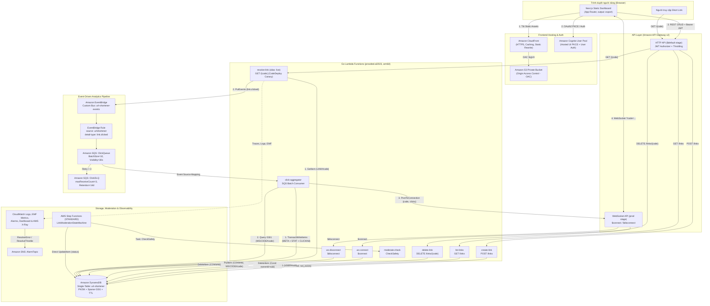
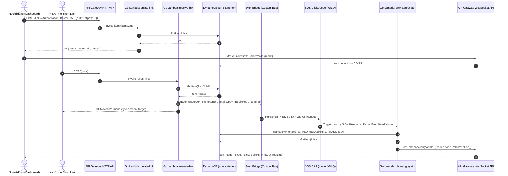
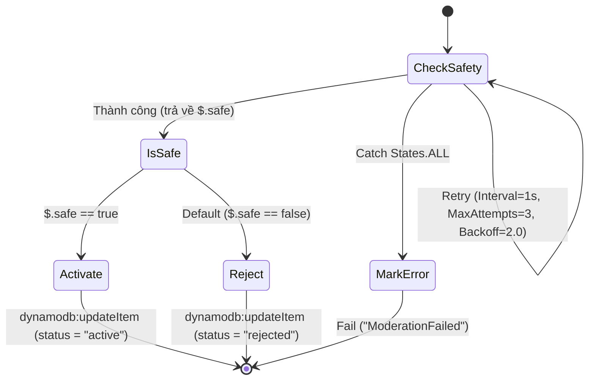

# Kiến Trúc Hệ Thống, Hợp Đồng API & Thiết Kế Dữ Liệu (Architecture & Contracts)

Tài liệu này định nghĩa đặc tả kỹ thuật chuẩn cho hệ thống **Serverless URL Shortener with Realtime Analytics** viết bằng **Golang**, quản lý hạ tầng bằng **Terraform**, và giao diện **Next.js Static Export** triển khai trên **Amazon S3 (Private) + CloudFront OAC**.

---

## 1. Sơ Đồ Kiến Trúc Tổng Thể (Mermaid)



---

## 2. Luồng Xử Lý Chi Tiết (Sequence Diagram)



---

## 3. Hợp Đồng Backend HTTP API (API Contract)

Hệ thống giữ nguyên 4 route HTTP cốt lõi trên stage `$default` của API Gateway HTTP API:

| Method | Endpoint | Authentication | Lambda Handler | Mô tả |
| --- | --- | --- | --- | --- |
| `POST` | `/links` | Cognito JWT Authorizer | `create-link` | Tạo link rút gọn mới thuộc sở hữu của `claims.sub` |
| `GET` | `/links` | Cognito JWT Authorizer | `list-links` | Liệt kê danh sách link của `claims.sub` (mới nhất trước) |
| `DELETE` | `/links/{code}` | Cognito JWT Authorizer | `delete-link` | Xóa link nếu tồn tại và thuộc sở hữu của `claims.sub` |
| `GET` | `/{code}` | Public (Không cần token) | `resolve-link` | Phát sự kiện `link.clicked` và trả `301` kèm header `Location` |

### 3.1 `POST /links`
- **Headers:** `Authorization: Bearer <Cognito_JWT>`, `Content-Type: application/json`
- **Request Body:**
  ```json
  {
    "url": "https://kubernetes.io/docs/home/"
  }
  ```
- **Quy tắc xử lý:**
  1. Lấy `ownerId` từ `event.RequestContext.Authorizer.JWT.Claims["sub"]`. Nếu rỗng trả `401 {"error": "thieu danh tinh nguoi dung"}`.
  2. Parse JSON body. Nếu lỗi cú pháp trả `400 {"error": "body khong phai JSON hop le"}`.
  3. Chuẩn hóa và kiểm tra URL: chỉ chấp nhận scheme `http` hoặc `https` có host hợp lệ. Nếu sai trả `400 {"error": "thieu hoac sai truong 'url' (chi nhan http/https)"}`.
  4. Sinh mã Base62 dài 7 ký tự (`0-9A-Za-z`) từ nguồn ngẫu nhiên mật mã (`crypto/rand`).
  5. Ghi vào DynamoDB với `ConditionExpression: "attribute_not_exists(PK)"`. Nếu gặp `ConditionalCheckFailedException`, thử lại tối đa **5 lần**. Sau 5 lần vẫn trùng trả `500 {"error": "khong sinh duoc ma duy nhat, thu lai"}`.
  6. Tạo `shortUrl` từ `PUBLIC_REDIRECT_BASE_URL` (hoặc `https://<domainName>`) + `/${code}`.
- **Response `201 Created` (`application/json`):**
  ```json
  {
    "code": "86Fgqtq",
    "shortUrl": "https://<api-id>.execute-api.ap-southeast-1.amazonaws.com/86Fgqtq",
    "target": "https://kubernetes.io/docs/home/"
  }
  ```

### 3.2 `GET /links`
- **Headers:** `Authorization: Bearer <Cognito_JWT>`
- **Quy tắc xử lý:**
  1. Lấy `ownerId` từ `claims["sub"]`. Nếu thiếu trả `401 {"error": "thieu danh tinh nguoi dung"}`.
  2. Thực hiện `Query` trên index `GSI1` với `KeyConditionExpression: "GSI1PK = :u"`, `:u = "USER#" + ownerId`, `ScanIndexForward = false` (sắp xếp theo `GSI1SK = LINK#<createdAt>` giảm dần). Tuyệt đối không dùng `Scan`.
- **Response `200 OK` (`application/json`):**
  ```json
  {
    "links": [
      {
        "code": "86Fgqtq",
        "target": "https://kubernetes.io/docs/home/",
        "clicks": 4,
        "createdAt": "2026-10-26T08:00:00.000Z"
      }
    ]
  }
  ```

### 3.3 `DELETE /links/{code}`
- **Headers:** `Authorization: Bearer <Cognito_JWT>`
- **Quy tắc xử lý:**
  1. Lấy `ownerId` từ `claims["sub"]` và `code` từ path parameter.
  2. Thực hiện `DeleteItem` trên `PK = "LINK#" + code, SK = "META"` với `ConditionExpression: "attribute_exists(PK) AND ownerId = :me"`, `:me = ownerId`.
  3. Nếu gặp `ConditionalCheckFailedException` (link không tồn tại **hoặc** thuộc người dùng khác), đều trả `404 Not Found` với cùng một thông báo để chống dò quét IDOR:
     ```json
     { "error": "link khong ton tai hoac khong thuoc ve ban" }
     ```
- **Response `200 OK` (`application/json`):**
  ```json
  {
    "deleted": "86Fgqtq"
  }
  ```

### 3.4 `GET /{code}`
- **Authentication:** Public
- **Quy tắc xử lý:**
  1. Thực hiện `GetItem` với `PK = "LINK#" + code, SK = "META"`.
  2. Nếu không tìm thấy item: ghi log cảnh báo `"link not found"`, phát CloudWatch EMF metric `LinkNotFound = 1` (namespace `UrlShortener`), trả `404 Not Found` (`text/plain`: `"khong tim thay link"`).
  3. Nếu tìm thấy: phát sự kiện lên EventBridge custom bus (`EVENT_BUS`):
     - `Source`: `"urlshortener"`
     - `DetailType`: `"link.clicked"`
     - `Detail`: `{"code": "<code_value>", "at": "<RFC3339_UTC_timestamp>"}`
  4. Ghi log info `"link resolved"`, phát CloudWatch EMF metric `LinkResolved = 1`, trả `301 Moved Permanently` với header `Location: <target>` và body rỗng `""`.

### 3.5 Quy Tắc Tách Biệt Domain (CloudFront vs. API Gateway)
- Giao diện Next.js chạy trên domain mặc định của **CloudFront** (`https://<dist>.cloudfront.net`).
- Các API và đường dẫn rút gọn `GET /{code}` chạy trực tiếp trên domain mặc định của **API Gateway HTTP API** (`https://<api-id>.execute-api.<region>.amazonaws.com`).
- Nhờ đó, `GET /{code}` ở gốc API Gateway không bao giờ xung đột với các route tĩnh của Next.js (`/`, `/login`, `/auth/callback`, `/dashboard`, `/links`), và `shortUrl` luôn trỏ chính xác về domain công khai của API Gateway.

---

## 4. Thiết Kế DynamoDB Single-Table & Giải Thích Access Patterns

### 4.1 Cấu Hình Bảng
- **Tên bảng mặc định:** `url-shortener` (cho phép cấu hình qua biến Terraform)
- **Billing mode:** `PAY_PER_REQUEST` (On-Demand)
- **Primary Key:** Partition Key `PK` (`S`), Sort Key `SK` (`S`)
- **Global Secondary Index (`GSI1`):** Partition Key `GSI1PK` (`S`), Sort Key `GSI1SK` (`S`), `ProjectionType: ALL`
- **Time To Live (TTL):** Bật trên thuộc tính `ttl` (Unix epoch seconds)

### 4.2 Bảng Thiết Kế 4 Thực Thể (Entities) & Đặc Tính Sparse Index

| Thực thể | `PK` | `SK` | `GSI1PK` | `GSI1SK` | Thuộc tính dữ liệu | `ttl` | Có mặt trong `GSI1`? |
| --- | --- | --- | --- | --- | --- | --- | --- |
| **Link Metadata** | `LINK#{code}` | `META` | `USER#{ownerId}` | `LINK#{createdAt}` | `target` (S), `ownerId` (S), `createdAt` (S), `clicks` (N), `status` (S, tùy chọn) | Không | **Có** (phục vụ tra cứu link theo chủ sở hữu) |
| **Daily Analytics** | `LINK#{code}` | `STAT#{YYYY-MM-DD}` | *(Không đặt)* | *(Không đặt)* | `count` (N) | Không | **Không** (Sparse: tự động bị loại khỏi `GSI1`) |
| **Idempotency Marker** | `CLICK#{eventId}` | `CLICK` | *(Không đặt)* | *(Không đặt)* | *(Không có)* | `now + 86400` (+24h) | **Không** (Sparse: tự động bị loại khỏi `GSI1`) |
| **WebSocket Connection** | `CONN#{connectionId}` | `META` | `WSCODE#{code}` | `CONN#{connectionId}` | `code` (S) | `now + 7200` (+2h) | **Có** (phục vụ tìm các kết nối đang nghe `code`) |

### 4.3 Chi Tiết Từng Access Pattern & Thao Tác DynamoDB

| # | Nghiệp vụ | Thao tác DynamoDB | Bảng / Index | Biểu thức Khóa / Điều kiện / Cập nhật | Giải thích kỹ thuật |
| --- | --- | --- | --- | --- | --- |
| **AP1** | Tạo link mới | `PutItem` | Bảng chính | `PK = LINK#{code}`, `SK = META`<br/>`ConditionExpression: attribute_not_exists(PK)` | Đảm bảo tính duy nhất của mã ngắn ngay ở tầng lưu trữ; nếu trùng mã sẽ ném `ConditionalCheckFailedException` để Lambda sinh mã khác (tối đa 5 lần). |
| **AP2** | Redirect & lấy URL đích | `GetItem` | Bảng chính | `PK = LINK#{code}`, `SK = META` | Truy xuất điểm (`O(1)`) độ trễ vài mili-giây theo khóa chính. |
| **AP3** | Liệt kê link của người dùng | `Query` | Index `GSI1` | `KeyConditionExpression: GSI1PK = :u` (`:u = USER#{ownerId}`), `ScanIndexForward = false` | Nhờ `GSI1SK = LINK#{createdAt}` theo chuẩn ISO-8601, kết quả được sắp xếp sẵn từ mới nhất đến cũ nhất trong 1 lệnh `Query` mà không cần `Scan`. |
| **AP4** | Xóa link của người dùng | `DeleteItem` | Bảng chính | `PK = LINK#{code}`, `SK = META`<br/>`ConditionExpression: attribute_exists(PK) AND ownerId = :me` | Kiểm tra quyền sở hữu và xóa trong một thao tác nguyên tử duy nhất, triệt tiêu lỗ hổng IDOR và race condition giữa bước kiểm tra và bước xóa. |
| **AP5** | Đếm click nguyên tử & chống trùng (Idempotent) | `TransactWriteItems` | Bảng chính | 1. `Update`: `PK=LINK#{code}, SK=META` → `ADD clicks :one`<br/>2. `Update`: `PK=LINK#{code}, SK=STAT#{YYYY-MM-DD}` → `ADD #c :one`<br/>3. `Put`: `PK=CLICK#{eventId}, SK=CLICK, ttl=+24h` với `ConditionExpression: attribute_not_exists(PK)` | Cả 3 thao tác thành công hoặc cùng hủy bỏ. Nếu `eventId` đã được xử lý trước đó, thao tác thứ 3 thất bại (`ConditionalCheckFailed`) làm hủy cả giao dịch, đảm bảo **exactly-once** cho bộ đếm. |
| **AP6** | Lưu kết nối WebSocket khi `$connect` | `PutItem` | Bảng chính | `PK = CONN#{connectionId}`, `SK = META`, `GSI1PK = WSCODE#{code}`, `GSI1SK = CONN#{connectionId}`, `ttl = +2h` | Lưu theo `CONN#{connectionId}` để xóa nhanh khi `$disconnect`, đồng thời chiếu vào `GSI1` dưới phân vùng `WSCODE#{code}`. |
| **AP7** | Xóa kết nối khi `$disconnect` hoặc gặp `410 Gone` | `DeleteItem` | Bảng chính | `PK = CONN#{connectionId}`, `SK = META` | Trong sự kiện `$disconnect`, API Gateway chỉ cung cấp `connectionId` (không còn query string `code`); nhờ `PK = CONN#{connectionId}`, ta xóa trực tiếp bằng `DeleteItem` mà không cần biết `code`. |
| **AP8** | Tìm các kết nối đang theo dõi một mã link | `Query` | Index `GSI1` | `KeyConditionExpression: GSI1PK = :p` (`:p = WSCODE#{code}`) | Trả về danh sách mọi `connectionId` đang mở cho mã `code` để gọi `PostToConnection`. |
| **AP9** | Cập nhật trạng thái kiểm duyệt link | `UpdateItem` | Bảng chính (Step Functions SDK integration) | `PK = LINK#{code}`, `SK = META`<br/>`UpdateExpression: SET #s = :active` (hoặc `:rejected`) | Step Functions gọi trực tiếp `arn:aws:states:::dynamodb:updateItem` mà không cần viết thêm Lambda phụ. |

---

## 5. Luồng Sự Kiện, SQS + DLQ, WebSocket & Step Functions

### 5.1 Event Schema (`link.clicked`)
```json
{
  "version": "0",
  "id": "fe8d3c65-4510-4b9a-9f1a-123456789abc",
  "detail-type": "link.clicked",
  "source": "urlshortener",
  "time": "2026-10-26T08:00:00Z",
  "region": "ap-southeast-1",
  "resources": [],
  "detail": {
    "code": "86Fgqtq",
    "at": "2026-10-26T08:00:00.000Z"
  }
}
```

### 5.2 Cấu Hình SQS & Xử Lý Lỗi Theo Lô (`ReportBatchItemFailures`)
- **ClickQueue:** `VisibilityTimeout = 30` giây (>= 6 lần timeout 5s của Lambda), `maxReceiveCount = 3`, `BatchSize = 10`.
- **ClickDLQ:** `MessageRetentionPeriod = 1209600` giây (14 ngày).
- **Partial Batch Failure:** `click-aggregator` trả về `events.SQSEventResponse{BatchItemFailures: ...}`. Chỉ những record gặp lỗi thực sự (JSON hỏng, thiếu `id`/`code`, hoặc lỗi DynamoDB ngoài duplicate) mới được thêm vào `BatchItemFailures` để SQS retry riêng lẻ.

### 5.3 Luồng Step Functions Moderation (`statemachine/moderation.asl.json`)

