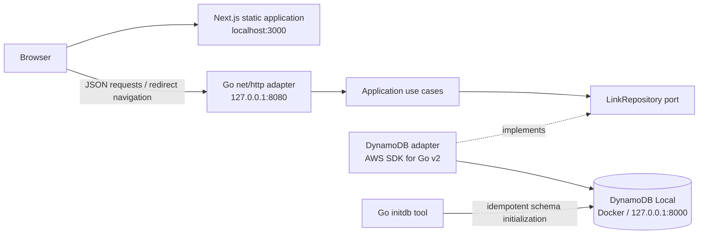
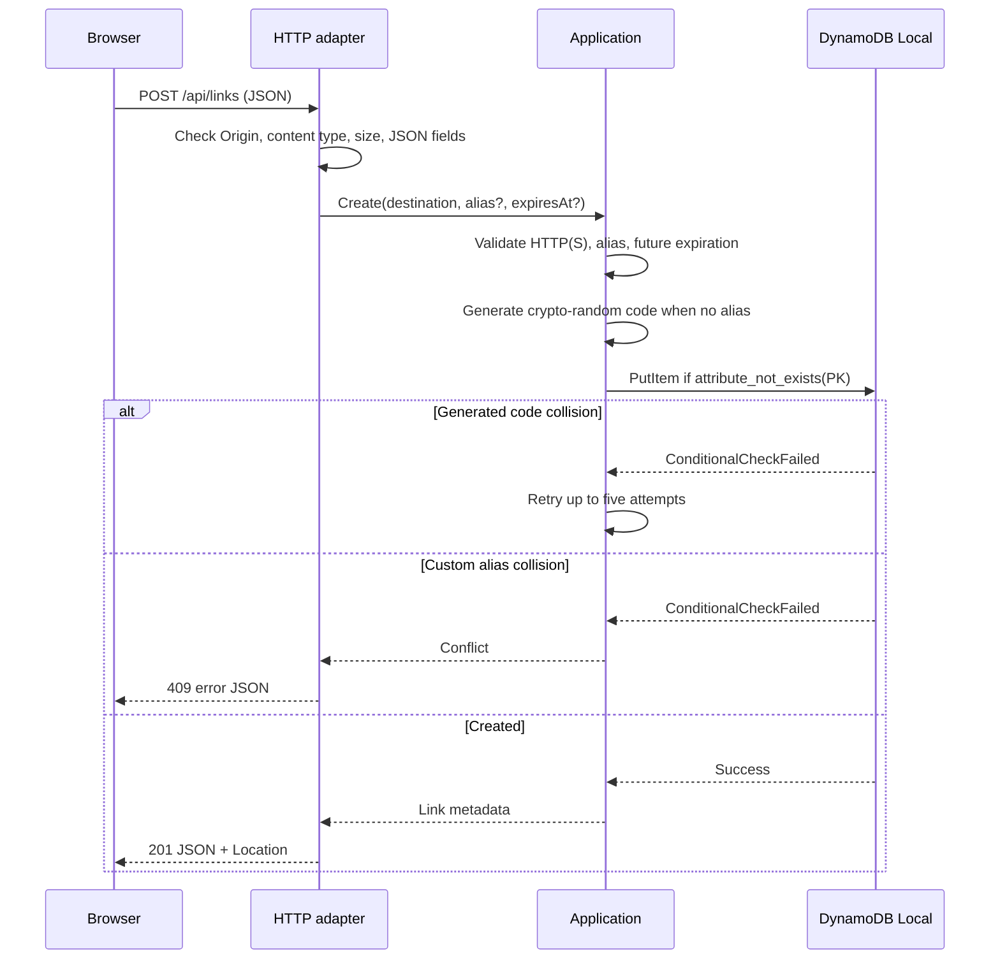
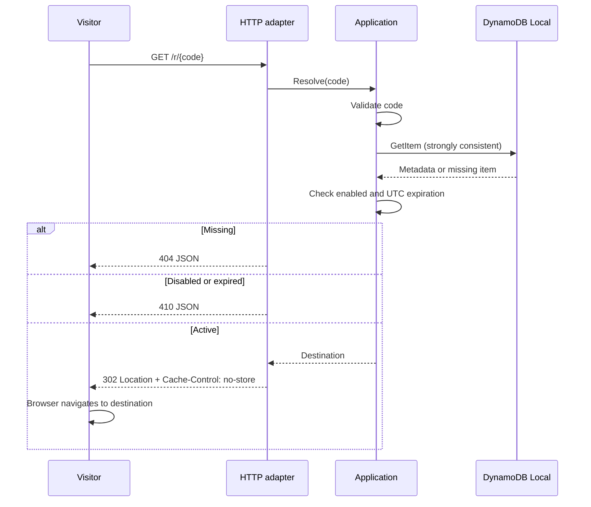
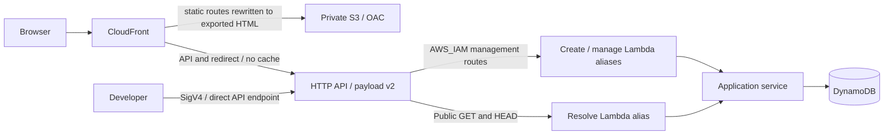

# Architecture and request flows

## Local system

The browser fetches API data after the static page loads. Next.js never contacts DynamoDB or serves the API. The dependency direction is inward: adapters depend on application/domain/ports; domain imports only Go's standard library. `cmd/api` assembles the dependencies. `internal/localconfig` is specific to host-run local programs, so it must not be reused as production AWS configuration.

## Single-table model

| Attribute                         | Value / purpose                                   |
| --------------------------------- | ------------------------------------------------- |
| `PK`                              | `LINK#<code>`; distributes direct lookups by code |
| `SK`                              | `METADATA`                                        |
| `GSI1PK`                          | `LINKS`; local collection                         |
| `GSI1SK`                          | Fixed-width UTC creation timestamp plus `#<code>` |
| `code`, `url`, `enabled`          | Link content and redirect control                 |
| `createdAt`, optional `expiresAt` | UTC timestamp attributes                          |

GSI1 projects all attributes. List queries run newest first, up to 25 items per request, with a cursor derived from the last evaluated key. Fixed-width fractional timestamps preserve lexical order. No full-table scans are needed. The index is eventually consistent; direct resolution and metadata gets are strongly consistent.

Expiry is an application rule. Records remain in the library after expiry and are not given a DynamoDB TTL. This avoids coupling availability to DynamoDB's asynchronous TTL deletion and preserves metadata for management. The API does not invent ownership attributes before authentication exists.

## Create Link

No validation step fetches the destination. Arbitrary URLs cannot cause server-side HTTP requests. Generated codes are identifiers, not authentication tokens.

## Redirect

No click event is published in Phase 01. The redirect Lambda can later publish events without putting analytics aggregation in the synchronous lookup path.

## Future AWS migration

| Phase | Increment                                                                                                 | Business-logic impact                                                                                  |
| ----- | --------------------------------------------------------------------------------------------------------- | ------------------------------------------------------------------------------------------------------ |
| 02    | Terraform, private S3 with OAC, CloudFront, HTTP API Gateway, native Go Lambda handlers, managed DynamoDB | Add Lambda transport and production configuration; reuse use cases and persistence port                |
| 03    | Cognito JWT authorizer, ownership checks, edit/delete/expiration management                               | Add authenticated actor context and owner-scoped storage queries; never trust client-supplied identity |
| 04    | EventBridge → SQS + DLQ → analytics Lambda → DynamoDB                                                     | Publish click events; build a separate idempotent consumer with retry handling                         |
| 05    | WebSocket updates and Step Functions URL moderation                                                       | Add connection management and explicit pending/approved/rejected moderation states                     |
| 06    | GitHub Actions, AWS OIDC, CloudWatch alarms, deployment gates, canaries, rollback, load/cost tests        | Add operational safeguards around verified behavior                                                    |

For the future private S3 REST origin, CloudFront must rewrite directory routes such as `/dashboard/` to `/dashboard/index.html`; a private S3 origin does not perform website-index routing. The frontend API base URL is embedded at build time and must be rebuilt for each target environment. Authentication/ownership must precede public management access, even if infrastructure is introduced first in a restricted environment.

The local index's `LINKS` partition must be reconsidered for ownership and traffic scale. Native Lambda adapters should translate API Gateway events to use-case inputs and convert domain errors to responses. They should not wrap or run the host HTTP server. AWS setup is deliberately absent from Phase 01.

## Phase 02A implementation

Native `create-link`, `manage-links` and `resolve-link` entrypoints reuse the application and DynamoDB adapter through payload-v2 handlers. Cloud bootstrap is separate from local configuration. The backend is deployed in Sydney; CloudFront is blocked by AWS account verification. See [AWS development](aws-development.md), [offline verification](phase-02-verification.md) and [deployment evidence](phase-02b-verification.md).

This diagram describes the target architecture: the direct API/Lambda/DynamoDB path is live, while CloudFront and its S3 bucket policy await account verification. The static export is uploaded to private S3. Browser cloud management waits for Cognito in Phase 03; local management remains unauthenticated and loopback-only. The intended public domain is `npt-shortenlink.dev`, attached after certificate/DNS checks during Phase 02B.

## References

- [Next.js static export documentation](https://nextjs.org/docs/app/guides/static-exports)
- [AWS SDK for Go v2 custom endpoints](https://docs.aws.amazon.com/sdk-for-go/v2/developer-guide/configure-endpoints.html)
- [DynamoDB Local usage notes](https://docs.aws.amazon.com/amazondynamodb/latest/developerguide/DynamoDBLocal.UsageNotes.html)
- [DynamoDB conditional writes](https://docs.aws.amazon.com/amazondynamodb/latest/developerguide/Expressions.ConditionExpressions.html)
- [shadcn/ui](https://ui.shadcn.com/docs)
