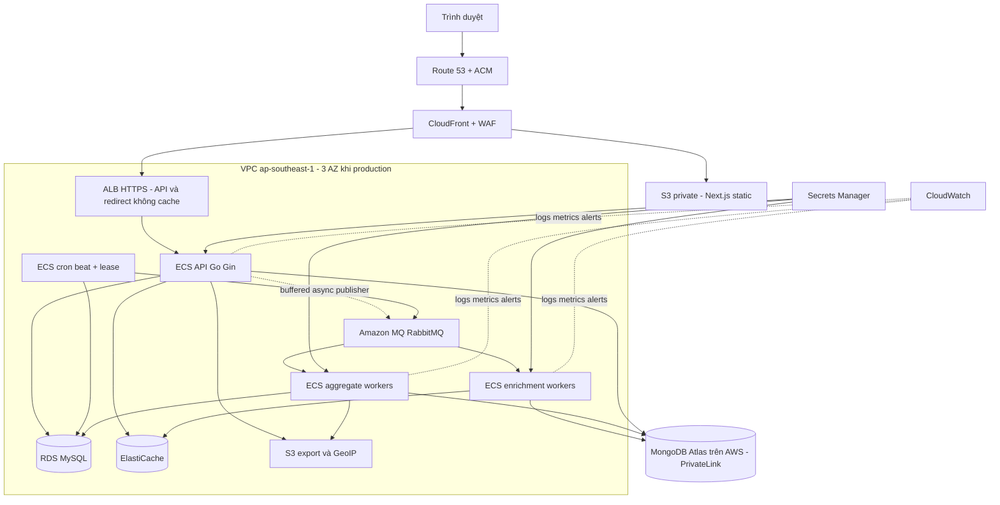

# Kiến trúc Go Gin và phương án triển khai AWS cho Shrnk

> **Đã được thay thế theo quyết định ngân sách ngày 12/11/2026.** Người dùng cho phép đổi hạ tầng và đặt mục tiêu dưới $20/tháng cho hệ thống mới. Dùng [kiến trúc Lambda tiết kiệm](2026-11-12-go-gin-budget-architecture.md) và [kế hoạch hiện hành](../plans/2026-11-12-go-gin-budget-plan.md). Bản HA bên dưới chỉ giữ làm tham chiếu mở rộng, không phải cấu hình ra mắt.

Ngày 12/11/2026. Trạng thái: thiết kế đề xuất theo SRS mới; chưa tạo hoặc thay đổi tài nguyên AWS.

**Quyết định chính:** xây và nghiệm thu hệ thống ở local bằng Docker Compose trước. Backend mới là Go/Gin REST API, giữ Next.js làm frontend. Khi local đạt gate, triển khai container lên ECS Fargate, dùng RDS MySQL, MongoDB Atlas trên AWS, ElastiCache và Amazon MQ RabbitMQ. Hệ thống AWS hiện tại tiếp tục được giữ nguyên đến khi có đợt chuyển đổi riêng.

## 1. Nguồn và phạm vi quyết định

- Nguồn yêu cầu hiện hành: [SRS Go Gin mới](../../requirements/SRS_URL_Shortener_Go_Gin.docx), đã đọc toàn bộ và kiểm tra bản render 3 trang. SHA256: `4746f5b7c0e4fd89bd454f9415e38113480c78b4bb55092a4f82974f654847c4`.
- Người dùng yêu cầu làm theo SRS mới và tự thiết kế AWS phù hợp, đồng thời đã định hướng hoàn thiện local trước, giữ nguyên tài nguyên AWS đang có.
- Tài liệu này thay phương án giữ Lambda/DynamoDB/Cognito làm kiến trúc đích trong bộ kế hoạch trước. Những câu lệnh/quy tắc trong SRS là yêu cầu thiết kế, không phải quyền thực thi lệnh hoặc triển khai.
- SRS mới giữ Next.js, dùng `config/config.yaml`, SQL thuần trong `db/`, không có `static/`, `templates/` hay `migrations/` trong backend. Không áp dụng phương án Go HTML console hoặc `app-config/config.json` của SRS cũ.
- SRS mới **không chốt** 5.000/8.000 RPS, p95 <10ms, raw retention 90 ngày, bcrypt cost 12 hay TTL token 15 phút/7 ngày. Các số tương tự bên dưới nếu có đều là đề xuất, không phải yêu cầu được kế thừa tự động.
- Khảo sát repository cho thấy nhiều thay đổi chưa commit trên nhánh `codex/home-theme`; phải giữ nguyên chúng. Bản thiết kế không dựa trên giả định môi trường AWS live đã được kiểm tra lại.

## 2. Vì sao chọn nền AWS này

Chọn **ECS Fargate** để chạy cùng ứng dụng container đã kiểm chứng local, có tiến trình HTTP, consumer RabbitMQ và beat scheduler hoạt động lâu dài. Không phải chuyển use case thành từng Lambda hoặc thay RabbitMQ bằng SQS để vừa với hạ tầng cũ. Fargate vận hành container mà không yêu cầu quản lý máy EC2; các database/broker vẫn có chi phí nền riêng. [AWS Fargate](https://docs.aws.amazon.com/AmazonECS/latest/developerguide/AWS_Fargate.html).

Phương án một EC2 chạy toàn bộ Compose thích hợp cho demo ngắn hạn, nhưng gom API, broker và database vào cùng điểm lỗi. EKS chưa có nhu cầu Kubernetes cụ thể để bù chi phí vận hành. ECS Fargate là kiến trúc đích đề xuất; chưa tạo hạ tầng để thử trong giai đoạn local.

| Thành phần | Local | AWS đề xuất | Lý do và giới hạn |
|---|---|---|---|
| Next.js | Next dev hoặc static export | S3 private + CloudFront OAC | Repo đang dùng static export; dashboard gọi REST API, chưa cần SSR server |
| Go/Gin REST API | Container `api` | ECS Fargate service + ALB | Router, middleware, lifecycle và auth ở một backend có module rõ ràng |
| Enrichment | `cronjob worker --queue=enrich.fast` | ECS Fargate service riêng | Scale độc lập, không để aggregation giữ worker nhanh |
| Aggregation/export | `cronjob worker --queue=aggregate.bulk` | ECS Fargate service riêng | Tác vụ dài có checkpoint và giới hạn concurrency |
| Cron/Beat | `cronjob beat` | ECS Fargate service, desired count 1 + lease | Dùng cùng logic cron local; chống chạy trùng khi rolling deployment |
| Users/RBAC/Links/Domains/jobs | MySQL container | RDS for MySQL | Giữ engine MySQL và SQL thuần; production Multi-AZ, backup/restore |
| `click_events`, `link_stats` | MongoDB replica set | MongoDB Atlas trên AWS, cùng region | Giữ đúng MongoDB và hành vi aggregation của local |
| Cache/quota/now | Redis container | ElastiCache for Valkey, tương thích Redis | Dùng command set chung, phải chạy integration trên cả hai engine trước cloud |
| Message broker | RabbitMQ | Amazon MQ for RabbitMQ | Giữ AMQP, queues riêng, publisher confirms, retry và DLQ |
| Image/config/secret | Image build và YAML local | ECR, Secrets Manager, config render lúc khởi động | Không ghi credential vào image hoặc repo |
| Export/GeoIP | Local filesystem qua adapter | S3 private theo prefix/version | Không dùng ổ đĩa task làm nơi lưu file export bền vững |
| Logs/metrics | Structured JSON và local metrics | CloudWatch Logs/metrics/alarms | Đo API, queue, jobs, data freshness và tracking loss riêng |

RDS MySQL được chọn để giữ SQL/engine chuẩn và dễ đối chiếu local; Aurora MySQL là phương án xem lại khi đo tải cho thấy cần đặc tính scaling/read replicas của Aurora. Không cần RDS Proxy mặc định với số Go process hữu hạn, có connection pools được giới hạn. [RDS MySQL](https://docs.aws.amazon.com/AmazonRDS/latest/UserGuide/CHAP_MySQL.html).

Atlas là dịch vụ do MongoDB vận hành **trên AWS**, không phải AWS first-party. Chọn Atlas để giữ parity với MongoDB trong SRS; DocumentDB có khác biệt chức năng, không được coi là thay thế tự động. Nếu có yêu cầu chỉ dùng dịch vụ AWS first-party, mở ADR riêng và chạy compatibility suite trước khi đổi. Production Atlas dùng dedicated tier hỗ trợ PrivateLink, có chi phí subscription/endpoint riêng. [Atlas private endpoints](https://www.mongodb.com/docs/atlas/security-private-endpoint/), [DocumentDB differences](https://docs.aws.amazon.com/documentdb/latest/devguide/functional-differences.html).

ElastiCache Valkey là thay đổi engine có chủ đích ở cloud, dùng giao thức Redis. Cache hit/TTL, Lua rate limiter và counters phải chạy cùng fixture với Redis local; không phụ thuộc module time-series riêng. Nếu suite không đạt, giữ ElastiCache Redis OSS cho lần ra mắt. [ElastiCache compatibility](https://docs.aws.amazon.com/AmazonElastiCache/latest/dg/engine-versions.html), [command support](https://docs.aws.amazon.com/AmazonElastiCache/latest/dg/SupportedCommands.html).

## 3. Sơ đồ kiến trúc đích



S3 là dịch vụ regional truy cập qua endpoint, không nằm vật lý trong subnet VPC. Sơ đồ nhóm nó cùng tài nguyên workload để thể hiện kết nối; Atlas ở VPC nhà cung cấp, kết nối private vào VPC ứng dụng.

## 4. Các tiến trình và cấu trúc source

Xây backend mới trong `backend-v2/` ở worktree thực thi riêng; backend Lambda cũ, frontend và Terraform hiện có được bảo toàn. Bên trong `backend-v2/` dùng layout SRS:

```text
cmd/server/main.go             # Gin API + composition root
cmd/cronjob/main.go            # Subcommand worker hoặc beat
cmd/cli/main.go                # Schema, index, backfill và import có mode rõ ràng
config/config.example.yaml    # Không chứa secret thật
db/*.sql                      # DDL và seed quyền, không auto-migrate
docker/                       # Dockerfiles + Compose local
internal/controller/          # DTO và mapping HTTP; gin.Context dừng ở đây
internal/initialize/          # Pools/clients và startup/shutdown
internal/middlewares/         # JWT, RBAC, quota, CORS, correlation
internal/models/              # Entity và storage DTO tách biệt
internal/repo/                # MySQL/Mongo/Redis/Rabbit adapters
internal/routers/             # Public/authenticated/admin route groups
internal/service/             # Use cases, ports và pipeline logic
pkg/{logger,response,setting,utils}/
global/                       # Chỉ bootstrap state tối thiểu; không mutable state rải rác
docs/                         # OpenAPI, event schema và vận hành
tests/                        # Unit, integration và contract
```

Không tạo thư mục rỗng chỉ để đủ cây. Không copy code thư viện vào `third_party/` khi Go modules đã quản lý dependency; thư mục này chỉ cần khi có license/asset thực. Gin phục vụ REST/redirect, không render giao diện; Next.js tiếp tục sở hữu pages, charts và admin UI. Gin hỗ trợ router/middleware; business service dùng `context.Context`, không nhận `*gin.Context`. [Gin documentation](https://gin-gonic.com/en/docs/).

Một image có thể chạy nhiều command, nhưng API, enrich, aggregate và beat là các task/service riêng. Không đặt beat trong mỗi replica API. Chưa rename `backend-v2` thành `backend` hoặc xóa code cũ trong giai đoạn local.

## 5. HTTP, auth và phân quyền

API canonical đề xuất: `/api/auth/register`, `/login`, `/refresh`, `/logout`; `/api/links` CRUD/pagination/filter; `/r/{code}` redirect; `/api/analytics/*`, `/api/admin/*`, `/api/jobs/*`, `/api/exports/*`; `/healthz`, `/readyz`. OpenAPI phải dùng đường dẫn đầy đủ, không diễn giải `/login` là root route: các thao tác auth đều dưới `/api/auth/`.

MySQL là nguồn users/roles và ownership; native register/login phát JWT. Đề xuất access 15 phút, refresh 7 ngày có rotation/revocation và lưu hash/identifier server-side; đây là giá trị mới cần review, không phải con số SRS mới quy định. Refresh cookie HttpOnly/Secure/SameSite, CSRF/Origin checks cho cookie actions; access token giữ trong memory của frontend. Password dùng thư viện bcrypt, cost được benchmark để pin; không tự viết crypto.

| Vai trò | Quyền đề xuất |
|---|---|
| user/owner | CRUD, xem và phân tích link của mình; role mặc định khi đăng ký |
| staff | Xem catalog và export được cho phép, không mutation kể cả đang là owner |
| analyst | Xem analytics/biểu đồ và export báo cáo, không ops hoặc mutation |
| admin | CRUD, quản lý quyền, suspend, cache invalidate/warm, chạy jobs/backfill |

Thêm `user` để thể hiện owner thường vì SRS mô tả owner CRUD nhưng chỉ liệt kê ba role quản trị. Role không có thứ tự kế thừa; ownership không vượt qua role read-only. Quyền/active account được kiểm tra server-side, cập nhật role không chờ JWT hết hạn. Admin suspension độc lập `is_active` của owner, owner không tự gỡ suspension.

Giữ client Next.js và UI đang có; auth/config/API client phải đổi có kiểm soát vì hiện đang bắt buộc Cognito/WebSocket URLs. Không bắt bản local mới phải kết nối Cognito hoặc API Gateway cũ. Luồng Google hiện tại chỉ giữ ở hệ thống cũ; việc thêm Google vào hệ thống mới hoặc chuyển tài khoản là phần migration riêng, không tự nối account bằng email.

## 6. Redirect, cache và tracking

### Tính đúng của cache

- MySQL lưu link với expiry, `is_active`, soft delete, suspension và revision. Short code unique theo so sánh phân biệt hoa/thường; không cấp lại code đã dùng. Giữ khả năng chứa alias cũ dài 32 ký tự khi chuẩn bị migration.
- Cache payload phải chứa target, expiry, state và revision; chỉ string URL không đủ để bảo vệ expiry/toggle. Đây là chi tiết kỹ thuật bổ sung cho mapping code→URL trong SRS.
- Cache hit vẫn kiểm điều kiện link và expiry; refresh TTL mặc định 1 giờ nhưng không vượt quá thời gian sống còn lại của link. Miss chỉ cache link còn hợp lệ. Redis lỗi thì fallback MySQL với deadline/pool limits, không retry vô hạn trên request.
- CRUD/toggle/delete/suspend cần invalidation có revision/fencing: thiết lập cache-bypass fence trước khi commit trạng thái; cấm cache fill từ generation cũ; cập nhật hoặc remove payload sau commit. Lỗi tạo fence thì mutation không commit; lỗi sau SQL commit giữ bypass và repair bằng outbox/reconciliation. Thử race cache-fill/mutation và crash ở từng ranh giới, không dùng một lệnh DEL làm bằng chứng lifecycle đã đúng.
- Không xóa toàn Redis bằng `FLUSHALL` từ admin UI. Warm/invalidate chỉ theo code/prefix được phép, có limit và audit; cũng phải tuân thủ revision/fence.

Endpoint mới `/r/{code}` trả **301** theo SRS, kèm `Cache-Control: private, no-store` để các lượt sau tiếp tục tới hệ thống kiểm trạng thái và tracking. CloudFront/API/error responses có TTL 0. Không có header này, 301 có thể được cache bởi client/proxy; Redis invalidation không xóa được browser cache. [HTTP 301](https://www.rfc-editor.org/rfc/rfc9110.html#section-15.4.2).

Đường cũ `/{code}` chỉ được nối sang backend mới ở pha cutover, có thể giữ 302 để tương thích client cũ. Domain/route collision phải được kiểm kê trước khi thêm root pages, health paths hoặc đổi rewrite.

### Bất đồng bộ và ranh giới đảm bảo

Handler tạo event ID ổn định, enqueue vào bounded in-process channel và trả redirect; publisher goroutine dùng persistent message + publisher confirms để gửi `enrich.fast`. Không truyền `gin.Context` sang goroutine; event là immutable DTO. Log writer cũng dùng buffer hữu hạn, không gọi network sink trực tiếp từ hot path.

Mặc định đề xuất ưu tiên redirect: channel đầy hoặc broker outage làm tăng `tracking_dropped`/`tracking_publish_failed`, không biến link hợp lệ thành lỗi. Không gọi cách này là zero loss: process crash trước broker confirm có thể mất click. Khi shutdown, dừng nhận request, drain publisher/log trong deadline và chỉ requeue những record chưa ack. Yêu cầu không mất bất kỳ click nào sẽ cần durable capture/WAL riêng và đánh giá lại latency; SRS mới chưa quy định điều đó.

## 7. Enrichment, aggregation và realtime

- `enrich.fast` và `aggregate.bulk` có consumer, prefetch, concurrency, retry budget và DLQ riêng. Chọn quorum queues cho AWS production RabbitMQ 4; local phải test cùng loại queue, không dùng mirrored classic theo ví dụ cũ. [Amazon MQ RabbitMQ 4](https://docs.aws.amazon.com/amazon-mq/latest/developer-guide/rabbitmq-4.html).
- Worker fast parse UA, GeoIP rồi gắn bot classification trước khi upsert MongoDB. Đề xuất giữ record với `is_bot` để có thể audit, nhưng loại bot khỏi KPI mặc định; lưu classifier/dataset version, không drop âm thầm record đã nhận.
- Unique index `event_id` là idempotency boundary. Ack chỉ sau Mongo upsert durable hoặc sau khi chuyển DLQ/handoff đã được confirm; retry không làm raw/rollup tăng hai lần. [RabbitMQ confirms](https://www.rabbitmq.com/docs/confirms).
- `click_events` là nguồn raw chuẩn; `link_stats` là kết quả tổng hợp có grain/window/algorithmVersion và unique index tương ứng. Snapshot được ghi đè theo generation, không cộng lại khi retry/backfill. Không cộng hourly unique thành daily unique.
- Redis `now` dùng time buckets, TTL và event dedupe; chỉ là read model tạm thời. Mongo và Redis không có transaction chung: có reconciliation sau crash/cache loss, UI thể hiện freshness/provisional, không lấy số Redis làm lịch sử chuẩn.
- Beat chạy minute/hour/day theo YAML; lease/fencing trong MySQL chống hai beat chạy đua. Job registry/outbox và checkpoint bảo vệ manual/scheduled/backfill; worker cũ không được ghi đè generation mới. Tác vụ lâu có thể chia window/day để resume.
- Lịch đề xuất: aggregate_window mỗi phút, rollup_hourly mỗi giờ, rollup_daily 00:05 UTC (07:05 Việt Nam), anomaly mỗi 5 phút, compact hàng tuần. Ngưỡng anomaly, retention, late-event window được pin thành config/ADR khi chuẩn bị thực thi, không lấy mặc định SRS cũ.
- Next.js lấy `now` qua polling 3–5 giây đề xuất, charts lấy Mongo rollup theo API có `asOf`. WebSocket owner-level là mở rộng nếu có yêu cầu push cụ thể; không bắt buộc giữ kiểu một socket mỗi link của frontend cũ.
- Raw retention và quyền đọc IP phải được chốt trước tạo TTL index. Các log, bản compacted, export, backup không được vô tình giữ raw lâu hơn policy đã chọn. GeoIP dùng địa chỉ client từ trust chain đã kiểm chứng, không tin X-Forwarded-For tùy ý.

## 8. Mạng, bảo mật và cấu hình AWS

Region đề xuất `ap-southeast-1`, khớp hướng triển khai hiện tại và gần người dùng Việt Nam. Production VPC có 3 AZ để đáp ứng broker cluster; API/tasks chạy private subnets, không public IP. RDS/ElastiCache/Amazon MQ là private. Atlas nối PrivateLink cùng region; không mở IP allowlist 0.0.0.0/0 để tiện kết nối.

CloudFront có S3 origin cho frontend và ALB origin cho API/redirect. ALB internet-facing chỉ nhận CloudFront managed prefix list, HTTPS và origin verification header; listener từ chối request thiếu header. Cách này giữ đường mở cho WebSocket khi cần; chưa dùng VPC origin để tránh đưa thêm ràng buộc giao thức trước khi chốt realtime. API behavior forward auth/cookie/Set-Cookie và không cache. WAF đặt tại CloudFront để thấy viewer IP, rule riêng cho login/create và redirect. [ALB origin protection](https://docs.aws.amazon.com/AmazonCloudFront/latest/DeveloperGuide/restrict-access-to-load-balancer.html), [CloudFront WebSockets](https://docs.aws.amazon.com/AmazonCloudFront/latest/DeveloperGuide/distribution-working-with.websockets.html).

Security groups chỉ cho task/service cần thiết truy cập dependency. Atlas PrivateLink có dynamic ports: không hard-code 27017 cho mọi endpoint, kiểm tra connection string và hướng dẫn Atlas trước viết SG. Data subnets không có internet route; task egress dùng endpoints cho ECR/S3/logs/secrets và NAT cho outbound thực sự cần. GeoIP database lấy từ S3 có version thay vì mỗi container tự tải internet.

Config vẫn là YAML như SRS. Local dùng file secret gitignored; AWS startup render YAML vào volume tạm từ secret injection + config không nhạy cảm rồi load thành struct immutable. Không bake secret vào image, không gửi secret xuống `NEXT_PUBLIC_*`, không log YAML đã resolve. Rotate secret phải rollout/reload có kiểm soát, không giả định task tự thấy giá trị mới.

Tách ECS execution role (pull image, logs, fetch secret) và task role (S3 prefix/API AWS thực sự cần). CI dùng OIDC, giới hạn deploy role vào tài nguyên `v2`; không gắn quyền admin account cho container. DB accounts theo service/use case, schema runner có role riêng. TLS và encryption at rest cho database, broker, cache, S3 và log destinations; private S3/OAC, KMS và policy scoped theo principal/resource. [S3 security](https://docs.aws.amazon.com/AmazonS3/latest/userguide/security-best-practices.html).

## 9. Capacity, observability và chi phí

Các con số sau là điểm khởi đầu để benchmark, không là cam kết throughput:

| Workload | Staging sau local gate | Production khởi điểm đề xuất | Scale signal |
|---|---|---|---|
| API | 1 task, 0.5 vCPU / 1 GiB | 2 task, mỗi task 1 vCPU / 2 GiB | ALB request/target, CPU, p95, connection pool |
| Enrich | 1 task, 0.5 vCPU / 1 GiB | 2 task, mỗi task 0.5 vCPU / 1 GiB | Queue age/backlog và throughput consumer |
| Aggregate/export | 1 task, 0.5 vCPU / 1 GiB | 1 task, 1 vCPU / 2 GiB; concurrency giới hạn | Bulk queue age, Mongo query time, job lag |
| Beat | 1 task, 0.25 vCPU / 0.5 GiB | 1 task + lease, catch-up sau restart | Lease, heartbeat và overdue jobs |
| Database/broker | Single-node chỉ cho staging tạm thời khi phù hợp dịch vụ | RDS Multi-AZ; Redis replica/failover; MQ 3-node cluster; Atlas dedicated | Connections, storage/IO, working set, broker disk/CPU |

API/beat dùng on-demand. Fargate Spot chỉ cân nhắc cho bulk job đã resume/idempotent; không mặc định dùng cho API hoặc nguồn tracking. Đặt max replicas và tổng DB pool budget: số task nhân pool không vượt connection budget dành cho ứng dụng.

Logs JSON phải có `request_id`, `task_id`, `latency`, `retries` đúng tên SRS; ngữ cảnh không có trường tương ứng dùng giá trị null/0 nhất quán. Bổ sung event_id/job_id và stage. Chọn `awslogs` non-blocking với buffer hữu hạn và metric/drop policy, không kỳ vọng buffer giữ log khi task chết. [ECS logging](https://docs.aws.amazon.com/AmazonECS/latest/APIReference/API_LogConfiguration.html).

RabbitMQ 4 trên Amazon MQ không vend metric từng queue qua CloudWatch. Beat/metrics collector lấy management API **không thường xuyên hơn mỗi phút**, chỉ các queue được quản lý; xuất snapshot/custom metrics cho queue depth, unacked, oldest age và consumer count. UI đọc snapshot có timestamp, không poll broker trên mỗi lần render. [MQ RabbitMQ 4 limitations](https://docs.aws.amazon.com/amazon-mq/latest/developer-guide/rabbitmq-4.html).

Theo dõi thêm publish failures/dropped, Mongo duplicate/upsert errors, bot counts, aggregation freshness, job lease/lag/failures, Redis misses, DB saturation và failed auth. `/healthz` kiểm process; `/readyz` phản ánh khả năng phục vụ core, dependency tùy chọn có trạng thái degraded; `/api/admin/health` hiển thị chi tiết cả MySQL/Redis/Mongo/Rabbit. Sự cố analytics không tự loại mọi API target khỏi ALB khi redirect vẫn phục vụ được.

Hệ này có chi phí nền cho RDS, MQ, Atlas, Redis, Fargate, ALB, NAT/PrivateLink; thường không có đặc tính trả tiền chỉ theo request như bản Lambda. Chưa có workload/budget nên không nêu giá USD giả định. Trước AWS apply phải lập estimate theo region, topology, hours, lưu trữ/retention, transfer, backups và logging; Atlas và PrivateLink có hóa đơn riêng. Giảm staging bằng thời gian chạy và size, không áp cấu hình demo single-node thành production HA.

## 10. Local gate, triển khai và chuyển đổi dữ liệu

1. **Local:** build backend-v2 + frontend Next.js, Compose MySQL/Mongo/Redis/Rabbit, DDL/index CLI, fixtures và e2e đầy đủ; máy local không dùng DB/queue AWS production. Không sửa AWS để giúp local test pass.
2. **Candidate release:** pin image digest, schema/index version, YAML schema, OpenAPI/event schema và frontend build; đo load/fault/drain. Local đạt không đồng nghĩa đã chứng minh HA/latency AWS.
3. **Staging AWS:** sau local gate và yêu cầu triển khai riêng, tạo stack `v2-staging` với Terraform state/key/roles/tên resource riêng; thử restore, PrivateLink, managed-engine parity, ALB/CloudFront headers, browser auth và load.
4. **Migration rehearsal:** export/import DynamoDB link sang MySQL giữ code/owner/target/expiry, ánh xạ Cognito sub vào legacy identity mapping. Không tạo password từ tài khoản Google; đăng nhập/link account cần chứng minh identity. Tổng click hiện có nhập thành legacy baseline; raw/geo/heatmap cũ không tự phục hồi được từ marker dedupe.
5. **Cutover:** có khoảng freeze link mutations hoặc delta sync đã thử; checksum/snapshot, warm cache, chuyển traffic có kiểm soát. Legacy click baseline có `asOf` và được đối soát lần cuối sau khi v1 queue/traffic đã drain, không lấy một snapshot đang còn tăng làm tổng cuối cùng. Rollback ứng dụng trong v2 dùng schema tương thích. Failback toàn hệ về v1 sau khi nhận writes v2 cần reverse sync/write freeze và identity plan; tài khoản native mới không tự đăng nhập được vào frontend Google-only cũ. Khi chưa chứng minh được failback này, chỉ cho canary read-only trước cutover, và dùng rollback release trong v2 sau khi mở writes.
6. **Giữ v1:** không destroy/apply vào stack AWS cũ trong quá trình local/staging. Chỉ xem xét ngừng tài nguyên cũ sau khi v2 ổn định và có yêu cầu riêng; tài nguyên giữ lại vẫn có chi phí hiện hữu.

Terraform nguồn cũ giữ nguyên. Tạo root `environments/v2-staging` và `environments/v2-production` với backend keys, biến, deploy roles và approval gates riêng; không đưa fixtures staging sang production. Atlas dùng provider/state/secret quản trị riêng có review. Không tự provision account/subscription Atlas trong bước viết thiết kế.

| Module dự kiến | Input chính | Output cho wiring |
|---|---|---|
| `v2_network` | Region, AZs, CIDRs, egress/endpoints | VPC/subnet IDs, endpoint IDs, SG boundaries |
| `v2_registry` | Image repository và retention policy | ECR repository URL; release pin digest riêng |
| `v2_data` | MySQL version, cache engine, storage/backup settings | Private endpoints, SG IDs, secret ARNs; không output password plaintext |
| `v2_broker` | RabbitMQ engine/queue policy, deployment mode | AMQPS/management endpoints, secret ARN, broker metrics |
| `v2_runtime` | Image digest, config/secret ARNs, subnet/SG, task roles | ECS services API/enrich/bulk/beat, task definitions, log groups |
| `v2_edge` | Frontend bucket/release, API ALB, hostname/cert | CloudFront URL, ALB target groups, WAF và origin guard |
| `v2_observability` | Service/queue/job dimensions và notification targets | Dashboards/alarms; queue custom metrics từ collector |
| Atlas stack | Region/tier, backup policy, private-endpoint request | Private connection string/endpoint IDs và secret reference |

Đây là hợp đồng module để triển khai sau local gate, chưa phải Terraform code hoặc plan đã apply. Bootstrap cũ không được đổi policy/state âm thầm để phục vụ root mới.

## 11. Ma trận đáp ứng SRS mới

| SRS | Thành phần sở hữu | Kiểm chứng cần có |
|---|---|---|
| §1 stack và §2 REST/layout/YAML/SQL | API, init, repo, Docker, Next.js | Build/pools/config validation; không auto-migrate hoặc render Go HTML |
| §3.1 register/login/JWT/refresh | Auth service + MySQL + frontend | Token rotation/revoke, password/role/disabled-account, CSRF |
| §3.2 owner CRUD/expiry/soft delete/filter | Link service + MySQL/Redis | Ownership, revision, expiry boundary, pagination/filter, tombstone |
| §3.2 User/IP quota/429 | Redis Lua + trusted proxy chain | Concurrent requests, Retry-After, spoofed IP và Redis failure |
| §3.3 301/cache TTL1h/fallback | Gin resolver + Redis/MySQL | Cache hit/miss/refresh/clamp, invalidation races, no browser/CDN cache |
| §3.3 non-blocking tracking | Bounded publisher + Rabbit | Redirect latency khi broker lỗi, drop metric, confirm/retry/drain |
| §3.4 UA/GeoIP/bots/upsert | Fast workers + Mongo | Stable ID/dedupe, bot flags, missing GeoIP, partial writes |
| §3.4 minute/hour/day aggregation | Beat + bulk workers + Mongo stats | Exact counts, unique/day, late events và rerun idempotent |
| §4.1 RBAC và ops | Server policy + Next admin | Ma trận role, direct API calls, owner không gỡ admin lock |
| §4.2 KPI/top10/heatmap/anomaly/health/jobs | Read APIs, Mongo, Redis, registry | Reconcile, freshness, queue snapshot, lease/backfill và audit |
| §5 log fields/async/latency/queue separation | Logger, middleware, services | Schema log, bounded buffers, measured p95/p99 và queue isolation |

Các cấu hình triển khai là đề xuất được người soạn quyết định theo quyền thiết kế kiến trúc; cần được review cùng cost/load evidence trước apply. Builder review độc lập theo SRS mới không còn câu hỏi quan trọng chưa xử lý; các tham số P0 vẫn cần được pin bằng bằng chứng trước implementation. [Kế hoạch local và các gate](../plans/2026-11-12-go-gin-local-first-plan.md) quy định thứ tự thực hiện.
