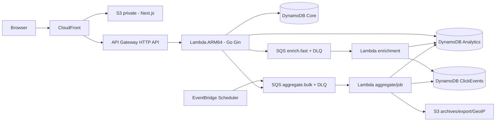

# Kiến trúc Go Gin với mục tiêu AWS dưới 20 USD mỗi tháng

Ngày 12/11/2026. Trạng thái: thiết kế theo các quyết định ngân sách mới; chưa triển khai AWS.

**Hướng đã chốt:** giữ Go/Gin, Next.js và nghiệp vụ SRS; người dùng cho phép đổi hạ tầng để giảm chi phí và đặt ngân sách AWS mới **dưới 20 USD/tháng**, chưa tính domain và tài nguyên v1 đang giữ. Xây local trước bằng cùng các biên API/data/queue sẽ dùng trên AWS. Phương án ECS/RDS/Atlas/ElastiCache/Amazon MQ trước đây chỉ còn là phương án mở rộng, không phải cấu hình ra mắt.

## 1. Quyết định và nguồn yêu cầu

- [SRS Go/Gin hiện hành](../../requirements/SRS_URL_Shortener_Go_Gin.docx) quy định nghiệp vụ auth/refresh, owner CRUD, expiry/toggle/soft delete, quota, redirect/tracking, enrichment/bot filtering, aggregation, RBAC, dashboard/jobs/export/health.
- Cho phép thay MySQL/MongoDB/Redis/RabbitMQ là quyết định mới trực tiếp từ người dùng, có ưu tiên hơn ràng buộc stack trong SRS. Không tiếp tục xây bốn engine local rồi đổi toàn bộ adapter khi deploy.
- Giữ Next.js; backend vẫn là REST API Gin, config YAML, không Go templates/static/migrations. Folder SQL `db/` không cần tạo vì không còn SQL engine; thay bằng schema/access-pattern và initializer có version cho DynamoDB.
- Không lấy các số RPS, latency, token/retention của SRS cũ làm yêu cầu mới. Các giá trị triển khai đề xuất bên dưới được ghi riêng.
- Không thay đổi/xóa tài nguyên v1, DNS, tài khoản hay dữ liệu cũ trong giai đoạn local. Budget này là phần hệ thống mới, không phải trần tổng bill account.

## 2. Kiến trúc ra mắt

| Thành phần | Lựa chọn | Chi phí nền được tránh |
|---|---|---|
| API | Lambda Event Functions on-demand ARM64 + HTTP API | Không ECS task/ALB chạy liên tục |
| Frontend | Next.js static export, S3 private + CloudFront | Không Next.js server thường trực |
| Auth/link/catalog | DynamoDB Standard on-demand | Không RDS, Aurora, proxy hoặc pool SQL |
| Raw/rollup/now/jobs | DynamoDB và S3 theo vai trò | Không Atlas/Mongo cluster hoặc Redis server |
| Fast/bulk queues | Hai SQS Standard queues, mỗi queue có DLQ | Không Amazon MQ broker |
| Schedule | Scheduler → SQS; Lambda xử lý job | Không beat service/VM chạy 24/7 |
| Config/signing key | YAML + SSM Standard SecureString, cache khi init | Chưa cần secret service/key trả phí riêng cho từng chức năng |
| Vận hành | Built-in metrics, 3 custom metric, 5 alarms dự kiến | Không dashboard/metrics có cardinality theo từng link/user |

Không có VPC/NAT, ALB, ElastiCache, RDS, Atlas, Amazon MQ, Provisioned Concurrency, Firehose/Athena hoặc WAF trả phí trong cấu hình mặc định. Tài nguyên kiểu này chỉ được thêm sau khi có workload và budget điều chỉnh. Mã hóa dùng khả năng mặc định/AWS-managed phù hợp, không tự thêm customer-managed KMS key có phí nền cho từng tài nguyên.

Gin dùng cùng router ở local và Lambda; entrypoint Lambda chuyển HTTP API v2 event qua adapter rồi gọi router. [AWS Labs Gin adapter](https://raw.githubusercontent.com/awslabs/aws-lambda-go-api-proxy/master/gin/adapterv2.go). Cold start là đánh đổi được chấp nhận trong cấu hình tiết kiệm; không cam kết mọi request đều <10ms hoặc cùng latency với container luôn nóng.

## 3. Dữ liệu và tính đúng

### Ba bảng với nhiệm vụ rõ ràng

- **Core:** user/profile, email/username reservation, refresh session, link/domain config, quota và idempotency. Link key giữ code ổn định; metadata có owner, target, expiresAt, enabled, deletedAt, adminSuspendedAt, revision. Không dùng DynamoDB TTL để xóa metadata link; TTL chỉ cho record tạm.
- **ClickEvents:** `PK=EVT#eventId`, `SK=RAW`, unique conditional put; chứa event time, code/owner, request ID, IP/UA/referrer và enrichment/bot versions. Một GSI time-bucket UTC theo ngày + 4 shard đề xuất, sort theo event time + event ID để Query cửa sổ; projection keys-only. Raw item tối đa 2 KiB trong budget envelope; header/field quá dài có normalization/truncation flag, không nhận payload không giới hạn.
- **Analytics:** lifetime/day/now counters, minute/hour/day snapshots, breakdowns, global KPIs/top10, alerts và job registry. Keys phân biệt grain/window/algorithmVersion/generation; dimension item có kích thước hữu hạn, không nhét map tăng vô hạn vào một item.

Click đã được chấp nhận ở resolver phải mang ID ổn định qua queue retry. Enrich dùng DynamoDB transaction để ghi raw mới và tăng counter một lần; duplicate không chạy lại side effect. Counter live/lifetime/day ở các item Analytics riêng nhỏ hơn 1 KiB; không cập nhật item Core chứa target URL dài cho mỗi click. Raw record là marker dedupe đồng thời là dữ liệu phân tích, không xóa marker trước raw. Bot giữ flag/provenance nhưng mặc định không vào KPI human clicks. Các event hợp lệ trước soft delete vẫn được lưu lịch sử khi consumer xử lý chậm.

Đề xuất raw retention 30 ngày, log 7 ngày, export 24 giờ; rollup retention theo ngân sách/dung lượng đo được. Đây là lựa chọn mới, không phải số trong SRS. Raw TTL xóa bất đồng bộ nên API/job phải kiểm cutoff thời gian. Queue/replay live chỉ trong horizon còn dedupe; backfill đọc raw/archive để ghi snapshot, không đưa event cũ trở lại đường tăng lifetime counter.

Raw source phục vụ cửa sổ hiện hành nằm ở DynamoDB để không phải query S3 theo từng click. S3 lưu GeoIP có version, file export và daily archive gzip/NDJSON theo batch. Không tạo một object S3 cho mỗi click, không dùng Athena để trả KPI mỗi lần mở dashboard.

### Truy vấn và quyền

Core có access patterns owner/date và global catalog bucket/shard; filter status/expiry được bound số evaluated items và trả cursor tiếp tục kể cả page ít kết quả. Chuyển `page/offset` của SRS sang cursor cho DynamoDB, UI có tiếp/trước; không hứa nhảy trang tùy ý hoặc đọc toàn bảng. Snapshot phục vụ các view global/heatmap; không Scan bảng trong HTTP handler.

Giữ native register/login/JWT/refresh và role policy; user thường CRUD của mình, staff/analyst read-only theo phạm vi đã định, admin có ops. Profile/role/active được kiểm tra hiện hành phía backend. Refresh token rotation và thu hồi qua record server-side; không phụ thuộc Cognito v1 để bản mới chạy được. Đề xuất access 15 phút, refresh 7 ngày; signing key được giữ ở SSM SecureString, không lộ vào frontend/YAML commit.

### Redirect và quota

Resolver đọc link metadata nhất quán trực tiếp từ DynamoDB để kiểm expiry, enabled, tombstone và suspension. Chưa có cache URL 1 giờ; đây là điều chỉnh rõ so với Redis cache trong SRS để giảm phí và tránh stale state. Đường mới `/r/{code}` giữ **301 + no-store**, CloudFront/API responses TTL 0. Alias dài 3–32/case-sensitive và URL policy cũ được bảo toàn khi migration.

Quota User/IP dùng DynamoDB conditional/CAS trên rolling window hữu hạn; TTL chỉ dọn record, không quyết định quota reset. Không lấy IP từ header do client tự gửi; trust chain CloudFront/API Gateway phải được kiểm chứng. API Gateway throttling và quota ứng dụng là kiểm soát tải, không phải trần hóa đơn tuyệt đối.

Không giả tạo nút warm cache URL khi không có cache URL. Ops tương ứng trong bản điều chỉnh là rebuild/invalidate analytics read model và kiểm trạng thái pipeline; UI hiển thị đúng capability, không gọi một no-op là warm cache. Đây là khác biệt kỹ thuật phải ghi trong phụ lục SRS.

## 4. Thích nghi với vòng đời Lambda

- Không dùng channel publisher/goroutine sau handler return làm nơi giữ telemetry. Handler gọi `SQS.SendMessage` có deadline trước khi trả 301; enrich/ghi raw/aggregate vẫn chạy bất đồng bộ. Có thêm thời gian enqueue nhỏ cần đo, không gọi đó là hoàn toàn không chặn network.
- Khi enqueue lỗi, ưu tiên redirect và ghi `TrackingPublishFailed`; không hứa zero loss hoặc tạo request lỗi cho URL hợp lệ. Nếu sau này cần zero loss trước broker, thiết kế durable capture riêng và tính lại chi phí/latency.
- Fast và bulk là hai event source mappings riêng, có batch failures/DLQ và giới hạn concurrency; không có polling loop thường trực trong Lambda. Dùng on-demand, không provisioned polling/concurrency mặc định.
- API không chạy cron. Scheduler gửi message cho bulk queue, job key dùng `(type, window, algorithmVersion)` để dedupe; manual request ghi job/outbox atomic rồi dispatch, có reconciliation nếu dispatch lỗi.
- Job lease/fencing + generation ngăn worker cũ ghi đè snapshot mới. Mỗi invocation có timeout/deadline hữu hạn; job dài chia ngày/shard/page, checkpoint và enqueue tiếp. Không cố giữ Lambda quá giới hạn runtime.
- GSI raw là eventual consistency: cửa sổ đóng có watermark, hiệu chỉnh late events trong 24 giờ đề xuất và rerun idempotent. Không cộng hourly unique thành daily unique; daily unique tính ở đúng scope ngày.
- Live/now cập nhật bởi fast consumer; frontend polling khi tab đang xem, pause khi tab ẩn, tối đa 3–5 giây theo profile đã đo. Không mở một socket/interval cho từng link, và không xem polling API là miễn phí.
- App emit JSON với `request_id`, `task_id`, `latency`, `retries`; platform chuyển log tới CloudWatch. Mọi I/O app cần thiết phải hoàn tất trong invocation; không dùng logger goroutine chưa flush rồi return. Sample success logs, giữ lỗi, không log token/raw IP/URL nhạy cảm.

## 5. Local trước và kiểm chứng tương đương

Giữ source mới tách khỏi backend v1 trong `backend-v2/` ở worktree thực thi riêng. Bên trong giữ layout Gin SRS, thêm `cmd/lambda-api`, `cmd/lambda-enrich`, `cmd/lambda-jobs`; local dùng `cmd/server`, `cmd/cronjob` và `cmd/cli` gọi chung services. HTTP/SQS events không đi vào domain service.

Compose local dùng DynamoDB Local, SQS-compatible emulator (ElasticMQ đã pin), local worker runner và object-store filesystem adapter. Cùng repo/service implementations và AWS SDK endpoint overrides được dùng cho local; không có MySQL/Mongo/Redis/Rabbit runtime bắt buộc. Dùng credentials giả + guard không cho local config trỏ AWS thật. [DynamoDB Local](https://docs.aws.amazon.com/amazondynamodb/latest/developerguide/DynamoDBLocal.DownloadingAndRunning.html), [ElasticMQ](https://github.com/softwaremill/elasticmq).

Emulator không chứng minh được IAM, TTL deletion timing, managed retry, latency, limits hoặc S3 signed URL trên AWS. Local gate bao gồm functional/race/idempotency/fault tests; sau đó mới có staging AWS giới hạn, cùng contract tests và cost measurement. Không sử dụng production v1 làm backend local.

## 6. Chi phí tham chiếu Singapore

Đơn giá lấy từ public AWS Price List, catalog công bố từ 19/10 đến 11/11/2026; ngày tra cứu 12/11/2026. Tính bằng script Decimal, không trừ Free Tier/credit; DynamoDB storage dùng paid marginal rate cho cả dung lượng mô hình để không dựa vào free allowance của account.

| Khoản | 100.000 click + 50.000 API/poll | 300.000 click + 150.000 API/poll |
|---|---:|---:|
| Lambda ARM | $1.04 | $1.67 |
| HTTP API | $0.19 | $0.56 |
| DynamoDB + metadata PITR | $1.35 | $3.38 |
| SQS, gồm allowance polling | $0.78 | $1.02 |
| CloudFront Asia | $0.61 | $1.82 |
| S3 | $0.10 | $0.10 |
| Logs + 3 custom metrics + 5 alarms | $1.77 | $2.13 |
| Allowance Scheduler/SSM/SNS/DNS/API extras | $1.00 | $1.00 |
| **Tổng mô hình** | **$6.84** | **$11.68** |
| Dự phòng 30% | $2.05 | $3.50 |
| **Ngân sách dự trù** | **$8.89** | **$15.18** |

Giả định: API 512 MiB/200ms trung bình, enrich 512 MiB/100ms mỗi click (không tính giảm nhờ batching), khoảng 53.326 job/tháng 512 MiB/2s, raw ≤2 KiB, envelope 12 write units và 4 read units/click cộng API/job overhead; CloudFront outbound 3 GB/100k click, thêm static requests; SQS có 1,5 triệu requests/tháng allowance empty polling. Phải đo các envelope này, không coi chúng là benchmark đã đạt. 3 custom metrics là **3 series tổng cộng**, không nhân thêm dimension theo function/user/code.

Ở kịch bản 1 triệu click + 500k API/poll, cùng giả định cho ra **$37.28 có dự phòng**, vượt budget. Như vậy “dưới $20” chỉ khả thi trong phạm vi tải/duration/data volume đã nêu, không phải mọi lượng traffic. Con số chưa gồm thuế, đăng ký domain và phần v1 được giữ; allowance là khoản dự trù, không phải đơn giá báo giá chính thức.

Nguồn và phép tính có thể kiểm tra ở [price snapshot](../../costs/2026-11-12-singapore-rates.json) và [calculator offline](../../costs/estimate_serverless.py). Chạy `python3 docs/costs/estimate_serverless.py` từ repo để tái lập; không dùng AWS credentials và không gọi AWS API. Giá tham khảo: [Lambda](https://aws.amazon.com/lambda/pricing/), [HTTP API](https://aws.amazon.com/api-gateway/pricing/), [DynamoDB](https://aws.amazon.com/dynamodb/pricing/), [SQS](https://aws.amazon.com/sqs/pricing/).

## 7. Kiểm soát budget và những gì chưa triển khai

- Target deploy resource cost ≤$15 trước dự phòng, cảnh báo actual/forecast ở $10/$15/$18 theo scope v2. Dùng metrics built-in, log retention 7 ngày, sample success logs, không custom dimensions theo từng link/user, không request debug tracing 100% mặc định.
- Giới hạn route burst/rate, concurrency worker, backfill date range/page budget, export size/TTL, active dashboard polling và job schedule. Không tự tạo thêm hạ tầng thường trực để “tối ưu hiệu năng” khi chưa đo.
- AWS Budgets cập nhật trễ, không phải hard spending cap. Không tự ngắt website, destroy tài nguyên hoặc gửi email khi chưa có yêu cầu triển khai/notification cụ thể. [AWS Budgets](https://docs.aws.amazon.com/cost-management/latest/userguide/budgets-managing-costs.html).
- Tách namespace/state/roles v2 khi tới staging, ưu tiên tích hợp/thay thế dần tài nguyên tương thích sau khi đã nghiệm thu; không nhân đôi AWS lâu dài để giữ budget rồi quên phần v1 vẫn phát sinh phí.
- Migration giữ code/owner/expiry/legacy click baseline và mapping identity. Không thể phục hồi raw/geo cũ từ marker count. Canary read-only trước mở writes; sau mở writes, rollback release trong v2 có schema tương thích, không chỉ đổi DNS về frontend Google-only v1.

Builder review độc lập đã kiểm tra nghiệp vụ SRS, Lambda lifecycle, data dedupe/jobs và calculator; không còn câu hỏi quan trọng chưa xử lý trong phạm vi thiết kế. Các con số workload/duration vẫn là giả định phải đo tại P5.

Lần lập kế hoạch này chỉ cập nhật tài liệu và calculator. Chưa sửa code ứng dụng, cấu hình cloud, dữ liệu, tài nguyên hoặc gửi notification. [Kế hoạch thực hiện](../plans/2026-11-12-go-gin-budget-plan.md) là đầu vào cho đợt local tiếp theo.
