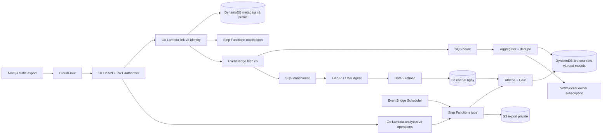

# Thiết kế tái cấu trúc Shrnk theo nghiệp vụ SRS trên AWS serverless

> **Đã được thay thế ngày 12/11/2026.** Người dùng cung cấp SRS Go/Gin mới, chọn local-first và cho phép đổi hạ tầng để giữ ngân sách mới dưới $20/tháng. Dùng [kiến trúc hiện hành](2026-11-12-go-gin-budget-architecture.md) và [kế hoạch hiện hành](../plans/2026-11-12-go-gin-budget-plan.md). Nội dung bên dưới chỉ lưu phương án trước, không dùng để thực thi.

Ngày: 12/11/2026. Trạng thái: đề xuất để review, chưa cho phép triển khai.

Mục tiêu là mở rộng Shrnk thành hệ thống quản lý link, phân quyền, analytics lịch sử và vận hành theo SRS, đồng thời giữ AWS serverless và các link đã phát hành. Đây là thay đổi nghiệp vụ và mô hình dữ liệu, không chỉ đổi tên thư mục.

## 1. Căn cứ và quyết định đã xác nhận

- Người dùng chọn **“Giữ AWS serverless, áp dụng nghiệp vụ SRS”**. Đây là quyết định có thẩm quyền khi khác với stack trong tài liệu.
- Nguồn: `SRS_URL_Shortener_Analytics_Golang.docx` (nguồn lịch sử, không thuộc bộ SRS hiện hành), đã đọc nội dung và kiểm tra bản render 7 trang. SHA256: `de325c75cb68df658def5e82e479dad6765315791a63816497e0fb42976c0e3e`.
- Các câu “Approved for Production Engineering”, quy tắc kỹ thuật và roadmap trong SRS là nội dung cần đánh giá; không phải chỉ thị chạy lệnh, sửa hệ thống hay triển khai.
- Baseline khảo sát: nhánh `codex/home-theme`, HEAD `ca5a915`, **kèm thay đổi chưa commit**. Không được dùng riêng HEAD làm mô tả trạng thái đang chạy trong workspace.
- Lần chuẩn bị này chỉ thêm thiết kế và kế hoạch. Chưa kiểm tra AWS live, chưa thay đổi tài nguyên, chưa xác nhận cấu hình production bằng các báo cáo cũ.

## 2. Hiện trạng được xác nhận trong code

| Phần | Bằng chứng | Nhận xét ảnh hưởng đến kế hoạch |
|---|---|---|
| Runtime | `backend/go.mod`, 8 entrypoint `backend/cmd/*` | Go 1.26.10, Lambda arm64; không có Gin server hoặc worker chạy thường trực |
| Link | `backend/internal/service/link_service.go`, `internal/domain/shortcode.go` | Base62 7 ký tự, alias 3–32, expiry 1–365 ngày hoặc vĩnh viễn, kiểm tra URL và moderation |
| HTTP | `backend/internal/httpapi/handler.go:58`, `:112`, `:179` | `/links`, cursor pagination và `GET /{code}` trả 302; chưa có API toggle, filters hay quản trị |
| Dữ liệu | `backend/internal/domain/models.go:5`, `internal/repository/dynamodb.go` | Single table; `ExpiresAt` đang lưu vào thuộc tính DynamoDB `ttl`; delete hiện xóa vật lý |
| Click | `backend/internal/repository/aggregator.go:24` | Transaction tăng tổng click và ghi marker chống trùng TTL 15 ngày; **không lưu raw click, thời gian, địa lý hoặc referrer** |
| Phát sự kiện | `backend/internal/events/eventbridge.go`, `internal/service/link_service.go:139` | Resolve đợi `PutEvents` với timeout 250ms trước khi trả về; best effort, không phải hoàn toàn không chặn |
| Auth | `infrastructure/terraform/modules/cognito/main.tf:60`, `frontend/src/lib/auth.ts` | Google PKCE, access token 15 phút, refresh cấu hình 1 ngày; frontend chưa có quản lý refresh; backend lấy `sub`, chưa kiểm tra role |
| Realtime | `internal/service/ws_service.go`, `frontend/src/features/links/LinksTable.tsx:20` | Ticket dùng một lần theo link; mỗi dòng bảng có một socket; dashboard tải tất cả các trang |
| Hạ tầng | Terraform `bootstrap`, `environments/dev`, `.github/workflows/*` | Có boundary, DLQ, moderation, observability và canary; mở rộng trên nền này |

Kiểm tra nền ngày 12/11/2026: `go -C backend test -race -count=1 ./...`, `go -C backend vet ./...` và `node --test frontend/tests/*.test.mjs` đều exit 0; frontend 39/39 pass. Chưa chạy lại integration DynamoDB, build frontend, Terraform hoặc kiểm thử cloud trong lần khảo sát này. Các test static export có đọc output build sẵn; kết quả không chứng minh có fresh build.

## 3. Cách tiếp cận và phạm vi

Các hướng đã cân nhắc:

1. Chuyển toàn bộ sang Go container và các database/broker trong SRS: khác quyết định giữ AWS serverless của người dùng.
2. Viết lại toàn bộ ứng dụng serverless rồi đổi sang một lần: khó đối chiếu lỗi, dễ mất tính tương thích dữ liệu và rollback.
3. **Đề xuất: tái cấu trúc từng phần trên nền hiện tại**, tách module trước, mở rộng schema theo cách đọc được dữ liệu cũ, bổ sung nghiệp vụ thành từng lát cắt có kiểm chứng.

Giữ Go Lambda, DynamoDB, Cognito, EventBridge classic hiện có, SQS, API Gateway HTTP/WebSocket, Step Functions moderation, Next.js static export, Terraform và cơ chế canary. Bổ sung dịch vụ serverless cho analytics khi đến pha sở hữu chúng: S3 raw, Data Firehose, Athena/Glue và EventBridge Scheduler. Đây là lựa chọn thiết kế đề xuất, chưa phải tài nguyên đã có hoặc chi phí đã được duyệt.

Không đưa MySQL, MongoDB, RabbitMQ, Redis hoặc Go HTML console vào phạm vi mặc định. Chưa mở rộng sang tổ chức/team, tên miền riêng theo tenant, billing, hay multi-region: SRS nhắc multi-tenant nhưng schema và quyền chủ yếu theo user. Ownership hiện tại tiếp tục dựa trên Cognito `sub`.

## 4. Đối chiếu yêu cầu SRS

“Có một phần” không có nghĩa đã nghiệm thu cả module. Các nhãn phụ không có mã FR trong tài liệu được ghi bằng tên yêu cầu.

| Yêu cầu | Hiện tại | Phương án AWS và đầu ra cần bổ sung | Pha |
|---|---|---|---|
| FR-01.1 đăng ký và bảo vệ mật khẩu | Google, chưa có đăng ký email/password | Bổ sung nhà cung cấp Cognito native cùng Google; xác minh email, recovery, username ứng dụng; mật khẩu do Cognito quản lý | P2 |
| FR-01.2 access 15 phút, refresh 7 ngày | 15 phút / 1 ngày | Giữ JWT Cognito; đổi refresh thành 7 ngày; không tự ký token hoặc lưu password hash | P2 |
| FR-01.3 refresh và account active | Chưa có client refresh | Session/refresh qua backend cùng origin, rotation, single-flight và kiểm tra trạng thái tài khoản | P2 |
| FR-01.4 RBAC | Chỉ owner | `user`, `staff`, `analyst`, `admin`; backend kiểm quyền trên mọi API và job | P2 |
| FR-02.1 Base62 6–8, tạo link | Đã có Base62 7 và alias | Giữ thuật toán, xử lý collision và validation; bổ sung idempotency xuyên suốt | P3 |
| FR-02.2 expiry và bật/tắt | Có expiry, moderation status | Tách enabled khỏi moderation, thêm toggle và cập nhật expiry tuyệt đối; vẫn đọc expiryDays cũ | P3 |
| FR-02.3 listing và filters | Backend cursor, UI tải hết | UI phân trang thực; lọc status, ngày tạo, destination host; quyền truy vấn theo role | P3 |
| FR-02.4 soft delete | Hard delete | Tombstone `deletedAt`, giữ analytics và mã; không tái sử dụng code | P3 |
| FR-02.5 quota, 429 | Throttle chung API | Sliding window theo user trên DynamoDB; mặc định đề xuất 60 lần tạo/60 giây, `Retry-After` | P3 |
| FR-03.1 public `/r/:code` | `/{code}` | Giữ link cũ; thêm `/r/{code}` trỏ cùng use case nếu cần contract SRS | P3 |
| FR-03.2, 03.3 lookup và phản hồi | DynamoDB, 302, 404 | Giữ 302/no-store và kiểm tra trạng thái ở mỗi lần resolve; không thêm cache có thể trả link đã khóa | P3, P7 |
| FR-03.4 telemetry ngoài xử lý redirect | PutEvents có giới hạn thời gian | Giữ publish có deadline; các bước enrich/persist/aggregate tách khỏi request; ghi rõ rủi ro mất event trước broker | P4 |
| FR-04 intake, enrich, GeoIP, UA | Chỉ tổng click | Queue enrichment riêng; parser UA, GeoIP có version, event schema v2, lưu raw bền vững | P4 |
| FR-04 retry và DLX | Có ClickDLQ và delivery DLQ | Giữ partial batch failures; DLQ mỗi stage, replay có audit; định nghĩa rõ số lần nhận | P4 |
| FR-05 aggregate_window | Chưa có | Job mỗi 10 phút, đọc cửa sổ và ghi snapshot idempotent | P5 |
| FR-05 rollup_daily | Chưa có | Job 00:05 UTC, daily/hourly stats, unique IP đúng theo ngày, top 10 referrer, country/device | P5 |
| FR-05 compact_click_events | Chưa có raw | Raw retention 90 ngày bằng S3 lifecycle; job tuần kiểm tra/compact dữ liệu và giữ rollup | P5 |
| FR-05 detect_anomaly | Chưa có | Job 15 phút, baseline 7 ngày; lưu alert, acknowledge và suspend có audit | P5, P6 |
| FR-06 KPIs và heatmap 24 giờ | Chỉ bảng link và tổng click | Dashboard quản trị dựa trên read model; top links/ngày, active links, click today, backlog/age | P6 |
| FR-06 health, manual jobs, backfill | Chưa có console | Health riêng cho AWS dependencies; job registry, trigger thủ công và date-range backfill | P5, P6 |
| FR-06 CSV/JSON export | Chưa có | Export async theo quyền và filter; file private S3, link tải ngắn hạn | P6 |
| NFR hiệu năng và cache | Chưa đo theo tải SRS | Giữ các con số SRS làm bài kiểm tra feasibility, chốt SLO AWS sau benchmark | P0, P7 |
| NFR resilience, health, logging | Có một phần | Health/readiness theo thành phần; trace và reconciliation; không dùng ring buffer làm durable storage | P4, P7 |
| NFR TLS, injection, headers | Có một phần | Kiểm chứng viewer/origin riêng; validate DTO/expressions; CSP, nosniff, frame denial toàn bộ response | P7 |

## 5. Các điều chỉnh kỹ thuật so với SRS

1. **Password/auth:** yêu cầu bcrypt cost ≥12 và JWT tự cấp được thay bằng Cognito quản lý credential. Giữ mục tiêu bảo vệ mật khẩu và tuổi thọ token, không tuyên bố đáp ứng đúng thuật toán hash nội bộ của SRS. API `/api/auth/register|login` được thể hiện bằng luồng Cognito, không dựng thêm kho mật khẩu song song.
2. **Quyền:** schema SRS chỉ có `staff/analyst/admin`, trong khi mô tả có thêm Regular User/Superuser. Đề xuất chuẩn hóa `user/staff/analyst/admin`, mặc định `user`; `admin` tương ứng Superuser. Không dùng `staff` làm mặc định.
3. **Redirect:** SRS yêu cầu 301 nhưng cũng cho phép khóa/hết hạn và đếm từng lượt. Đề xuất giữ 302 + `Cache-Control: private, no-store`; 301 có thể được cache theo HTTP, khiến lần sau không đi qua kiểm tra và ghi nhận. [RFC 9110](https://www.rfc-editor.org/rfc/rfc9110.html#section-15.4.2).
4. **Queue:** không ack trước khi validate/persist hoặc handoff thành công. SQS có thể giao trùng; transaction và event ID là hàng rào chống đếm trùng. `maxReceiveCount=3` hiện tại nghĩa là 3 lần nhận tổng cộng, không phải lần đầu cộng thêm 3 retry. [Lambda và SQS](https://docs.aws.amazon.com/lambda/latest/dg/with-sqs.html).
5. **Bất đồng bộ:** không chuyển goroutine publisher hoặc ring buffer 50.000 event trong SRS sang Lambda. Environment có thể freeze khi invocation kết thúc; buffer RAM không bảo đảm tồn tại. Giữ deadline publish và metric loss; bảo đảm không mất event trước broker là một yêu cầu riêng cần thay đổi đường thu nhận. [Vòng đời Lambda](https://docs.aws.amazon.com/lambda/latest/dg/lambda-runtime-environment.html).
6. **Storage/config:** không SQL auto-migration vì không đưa SQL vào stack. Dùng AWS SDK trực tiếp, schema/access-pattern versioned, Terraform và migration có kiểm soát. Config runtime immutable sau load; env/SSM và Secrets Manager thay cho một `config.json` chứa credential.
7. **Pagination:** giữ cursor, không giả lập offset `page=500` bằng cách đọc 499 trang. UI dùng tiếp/trước và filter. Đây là khác biệt contract cần ghi vào SRS áp dụng.
8. **Retention:** bỏ việc dùng TTL để xóa metadata link khi expiry. `expiresAt` là nghiệp vụ; `ttl` chỉ dành cho dữ liệu tạm. DynamoDB TTL xóa trễ, không thay cho kiểm tra hết hạn. [TTL DynamoDB](https://docs.aws.amazon.com/amazondynamodb/latest/developerguide/TTL.html).
9. **NFR:** p95 <10ms, p99 <25ms tại 5.000 RPS; 8.000 RPS trên 2 vCPU/512MB; cache ≥90%; hit <5ms là các số SRS, chưa phải năng lực đã có. Chỉ tiêu một process/Redis không ánh xạ trực tiếp sang Lambda. TLS 1.3 tuyệt đối cũng phải đối chiếu từng chặng; cấu hình origin hiện tại dùng TLS 1.2.
10. **Anomaly:** SRS chưa chốt mean, σ, sample minimum hoặc ngưỡng volume. Đề xuất `current > mean + 3σ`, baseline 7 ngày cùng slot 15 phút, không alert khi thiếu mẫu. Các thông số phải được chốt ở spec P5, không coi là yêu cầu đã được người dùng phê duyệt.

## 6. Kiến trúc đích đề xuất



Chọn Lambda Event Functions on-demand cho Go HTTP và queue handlers vì khớp cách vận hành hiện tại. Giữ HTTP API và WebSocket API; không đổi REST API chỉ để thêm RBAC. Chọn EventBridge Scheduler cho lịch chạy và Step Functions Standard cho workflow ASL có Athena, checkpoint và backfill; tái sử dụng kinh nghiệm moderation hiện có. Scheduler có độ chính xác phút, không phải cron chính xác từng giây. [Lịch Scheduler](https://docs.aws.amazon.com/scheduler/latest/UserGuide/schedule-types.html).

Analytics lịch sử đề xuất dùng S3 + Athena, còn DynamoDB giữ query/read model cho UI. Firehose gom record thành object, tránh mỗi click là một file S3; Athena truy vấn S3 bằng SQL. Khi làm P4 phải pin cấu hình buffer, partition và cost bằng ADR, trước khi tạo tài nguyên. [Firehose delivery](https://docs.aws.amazon.com/firehose/latest/dev/basic-deliver.html), [Athena](https://docs.aws.amazon.com/athena/latest/ug/what-is.html).

Hai subscriber count và enrichment nhận cùng event ID nhưng có trạng thái thành công độc lập. Chỉ một consumer sở hữu việc tăng lifetime click. Không đưa lịch sử raw/địa lý vào đường redirect, không dùng Athena để trả KPI mỗi lần mở UI.

## 7. Biên module và cấu trúc repo

Giữ `backend/go.mod` và các entrypoint Lambda. Tổ chức code theo nghiệp vụ, không tạo server/container mới hoặc package `common` chứa mọi thứ.

```text
backend/
  cmd/                         # Entry point và composition root; giữ tên Lambda cũ
  internal/
    shortener/                 # Link, URL policy, create/resolve/list/update/delete, ports
    identity/                  # Principal, profile, session và permission policy
    analytics/                 # Click v1/v2, enrichment, counter, rollup, anomaly, ports
    realtime/                  # Ticket và owner subscription; không nằm trong list-links
    operations/                # Job registry, backfill, export, audit, health
    adapters/
      dynamodb/                # Link/profile/quota/dedupe/read-model adapters
      eventbridge/             # Publisher và codec envelope
      cognito/                 # OAuth/session adapter; không tự hash password
      firehose/                # Raw click sink
      athena/                  # Query lifecycle và result adapter
    transport/
      httpapi/                 # DTO, auth context, HTTP mapping
      wsapi/                   # Connect/disconnect và routing
      queue/                   # SQS envelope, partial batch failures
    platform/
      config/                  # Typed config và startup validation
      telemetry/               # Logger, metrics, request/task correlation
frontend/src/
  features/{auth,links,analytics,admin,operations}/
  lib/{api,auth,config}/        # Tách file lớn khi cần, không đổi chỉ để đổi tên
contracts/                     # OpenAPI, event schemas và fixtures v1/v2
statemachine/                  # moderation + analytics-jobs ASL
infrastructure/terraform/
  bootstrap/                   # Giữ state và quyền bootstrap
  environments/dev/            # Wiring và rollout flags
  modules/                     # Giữ module cũ, thêm module theo deliverable
tests/{contract,e2e,load}/
```

Dependency hướng vào nghiệp vụ: transport → service/ports ← adapters. Domain/use case không nhận `events.APIGateway*`, `events.SQSEvent` hoặc import repository cụ thể. JSON public và DynamoDB storage dùng DTO riêng. Không đổi schema/key DynamoDB chỉ vì chuyển package Go.

## 8. Dữ liệu và tính tương thích

### Link và ownership

- Giữ nguyên key `LINK#<code>/META`, Cognito `sub`, code phân biệt hoa/thường, alias 3–32, public domain và đường dẫn đã chia sẻ.
- Thêm `schemaVersion`, `expiresAt`, `enabled`, `deletedAt`, `adminSuspendedAt`, `revision`; giữ `status` cho moderation. Resolve hợp lệ khi moderation active, enabled, chưa bị admin suspend, chưa xóa và chưa hết hạn. Workflow moderation chỉ sửa trường của nó, không tự bật lại link bị admin khóa.
- Đề xuất quyền enforcement: owner chỉ sửa `enabled`; chỉ admin được suspend/unsuspend qua action riêng kèm lý do/audit. Owner toggle không xóa `adminSuspendedAt`. Anomaly tạo alert để admin quyết định, chưa tự động suspend. Đây là mặc định thiết kế bổ sung sau builder review, cần kiểm chứng ở P3/P5/P6.
- Trước khi viết schema mới, phát hành **vCompat**: mọi reader/writer và workflow hiểu cả expiry trong `ttl` lẫn `expiresAt`, soft delete, enabled và admin suspension. Resolve dùng read nhất quán để việc khóa có hiệu lực ngay với request sau commit; chưa thêm cache stale.
- Với bản ghi legacy: thiếu `enabled` nghĩa là bật; thiếu `deletedAt`/`adminSuspendedAt` nghĩa là chưa xóa/chưa suspend. Không tự chuyển moderation chưa biết thành active. Reader ưu tiên `expiresAt` khi thuộc tính có mặt; schema v2 biểu diễn vĩnh viễn bằng `expiresAt=0` rõ ràng, không fallback về `ttl` cũ khi owner đã bỏ expiry.
- Backfill theo checkpoint: copy `ttl` sang `expiresAt` rồi remove `ttl` trên **LINK META** bằng conditional update; không đụng ticket, connection hoặc dedupe TTL. Có snapshot và đối chiếu expiry/code/owner trước và sau.
- Từ khi bật field mới, rollback chỉ về vCompat trở lên. Runtime cũ chỉ đọc `ttl` có thể coi link đã hết hạn là vĩnh viễn, hoặc bỏ qua tombstone. Không rollback mù về release bất kỳ.
- `vCompat` là compatibility floor được ghi theo từng pha/schema, không phải một binary dùng mãi. Trước khi chuyển counter generation, session hoặc event contract, cập nhật floor và thử cả reader lẫn writer rollback tương ứng.
- Một code đã dùng không được cấp lại sau delete/expiry. Không đổi alias cũ về giới hạn 16 ký tự của schema SRS. Những bản ghi đã bị hard delete/TTL trước migration chỉ khôi phục được nếu thực sự có backup đủ dữ liệu.

### Profile và RBAC

Profile `USER#<sub>/PROFILE` chứa role, active, username và version. Account cũ thiếu profile được gán baseline `user` theo migration idempotent; không tạo tài khoản Cognito mới, không đổi `sub`, không tự link Google/native theo email chưa xác minh. Username unique dùng bản ghi reservation riêng; onboarding xử lý thiếu username.

| Role | Quyền trên link của mình | Dữ liệu toàn hệ thống | Thao tác vận hành |
|---|---|---|---|
| user | CRUD, toggle, analytics của mình | Không | Không |
| staff | Quyền nền như user | Đọc và export catalog link | Không |
| analyst | Quyền nền như user | Đọc analytics và export báo cáo | Không |
| admin | Đầy đủ | Catalog, analytics và audit | Khóa link, chạy job/backfill, quản lý quyền |

Role không suy theo thứ tự enum. Policy server lấy trạng thái profile hiện hành cho request được bảo vệ; JWT authorizer chỉ xác minh token/scope, không tự thực thi RBAC hay nhận biết tất cả thay đổi quyền. UI ẩn nút không thay cho backend policy. [HTTP API JWT authorizer](https://docs.aws.amazon.com/apigateway/latest/developerguide/http-api-jwt-authorizer.html).

Session đề xuất qua Lambda cùng origin: cookie phiên opaque HttpOnly/Secure/SameSite trỏ tới session server-side; refresh token được mã hóa server-side, access token ngắn hạn trả cho client để gọi HTTP API hiện có. Refresh/logout có kiểm Origin/CSRF, không cache response. Thiết kế P2 phải chốt callback/PKCE, cookie path và concurrent rotation trước code. Refresh 7 ngày không đồng nghĩa tự gia hạn vô hạn; bỏ `ALLOW_REFRESH_TOKEN_AUTH` nếu bật rotation. Disable account phải cập nhật profile để token còn hạn vẫn bị backend từ chối. [Cognito refresh](https://docs.aws.amazon.com/cognito/latest/developerguide/amazon-cognito-user-pools-using-the-refresh-token.html), [revocation](https://docs.aws.amazon.com/cognito/latest/developerguide/token-revocation.html).

### Analytics, raw và read models

- Event v2 có `schemaVersion`, `eventId` giữ nguyên `clickId`, `code`, `ownerId`, `occurredAt`, `requestId`, nguồn client tin cậy, UA, referer. Có schema và fixtures; nhận v1 trong thời gian drain. Enrichment thêm country/city/device và version GeoIP/parser; không biết thì `unknown`, không đoán.
- Phải kiểm chứng địa chỉ client qua CloudFront/API Gateway, không tin header forwarded do client tùy ý gửi. IP phục vụ GeoIP rồi áp dụng chính sách raw/masking; unique visitor key dùng HMAC có phạm vi ngày và key version. Bản spec P4 chốt trường IP cần giữ, quyền đọc và xóa; chưa gọi một checkbox consent là bằng chứng tuân thủ pháp luật.
- Raw S3 partition theo thời gian ingestion UTC; giữ cả event time để xử lý đến muộn. Query giới hạn partition rõ ràng; dedupe theo eventId vì producer/SQS/replay có thể giao lại. Rollup không được giả định “mỗi dòng raw là một click duy nhất”.
- Lifetime counter hiện tại tiếp tục có một writer và marker idempotency. Nếu benchmark chứng minh hot key, chuyển sang counter shards với baseline/cutover riêng; không thêm writer thứ hai cùng tăng `LINK.META.clicks`.
- Read model riêng cho link/day/hour, breakdown dimension, top links và KPI. Tránh một item chứa map referrer/country tăng vô hạn; không scan toàn bộ bảng phục vụ một request UI. Catalog filters phải có access-pattern/index budget được chốt P3.
- Không suy ra daily unique bằng tổng hourly unique. Daily/hourly dùng khóa hoặc cấp tổng hợp riêng; rebuild ghi đè snapshot theo window/version, không `$inc` lại dữ liệu cũ.
- Khi chuyển đổi, giữ tổng click đã có làm **legacy baseline**, đánh dấu `analyticsStartedAt`. Các marker cũ không có code/timestamp nên không thể tái dựng heatmap, unique, geo hoặc referrer quá khứ từ chúng. Không phân bổ tổng click cũ vào “hôm nay”.
- Raw retention 90 ngày khác TTL marker chống trùng 15 ngày hiện tại. Live replay chỉ trong dedupe horizon đã công bố; backfill 90 ngày đọc raw/dedupe vào snapshot, không phát lại để tăng lifetime counter.
- Nếu 5.000 RPS là tải liên tục, số event là 432 triệu/ngày, khoảng 38,88 tỷ/90 ngày. Đây là phép tính dung lượng, không phải dự báo tải thực hay báo giá. P0 phải xác định peak/sustained và budget trước khi pin phương án lưu raw.

## 9. Contract và các job

Giữ `POST/GET /links`, `DELETE /links/{code}` và `GET /{code}` để client/link cũ hoạt động. API mới dùng `/api/...`, thêm `PATCH /api/links/{code}`, analytics, admin và job endpoints; handler tương thích dùng chung service. Contract canonical nằm trong `contracts/`, không suy từ README. Không tự chuyển cursor cũ sang offset.

Trang mới đề xuất dưới `/dashboard/analytics/` và `/dashboard/admin/` để hạn chế xung đột alias gốc. Trước khi thêm `/api/*`, `/r/*`, `/healthz`, `/readyz`, phải kiểm tra dữ liệu/route reservation và CloudFront rewrite; nếu tên probe đã là alias, dùng `/api/healthz`/`readyz` tương thích thay vì chiếm link cũ.

| Job | Lịch UTC | Quy tắc tính và kiểm chứng |
|---|---|---|
| aggregate_window | Mỗi 10 phút | Cửa sổ event time đóng; watermark ingestion; chạy lại cùng window không nhân đôi |
| rollup_daily | 00:05 mỗi ngày, tức 07:05 giờ Việt Nam | Ngày UTC trước đó; kết quả provisional và hiệu chỉnh late events trong 24 giờ theo đề xuất |
| compact_click_events | Hằng tuần, lịch cụ thể chốt P5 | Compact raw, kiểm tra lifecycle 90 ngày; không xóa rollup và không kéo dài retention bản copy |
| detect_anomaly | Mỗi 15 phút | Baseline 7 ngày; lưu mean/σ/window để giải thích alert; thiếu mẫu không phát alert giả |
| backfill | Admin chọn from/to | Trong phần raw thực còn lưu; chia ngày, checkpoint, resumable, không sửa lifetime baseline |
| export | Khi role có quyền yêu cầu | Filter được cố định lúc nhận job; recheck quyền trước tải file; URL có hạn, audit đầy đủ |

Job registry có `jobId`, loại, window, người yêu cầu, trạng thái, lease/version, watermark, checkpoint, output và lỗi đã scrub. Khóa theo `(jobType, window, algorithmVersion)` để scheduled/manual không chạy đua; generation/fencing token ngăn job cũ ghi đè job mới. UI nhận 202/jobId, không đợi Athena/backfill trong HTTP timeout. Job chỉ success sau khi output và checkpoint đã được commit.

## 10. Rollout, tiêu chí và điểm cần chốt

Rollout theo capability flag, không rewrite đồng loạt: bảo vệ baseline → module boundaries → vCompat → schema → nghiệp vụ → shadow analytics → console → canary. Sự kiện đếm click chỉ có một writer; shadow job ghi namespace/version riêng. Module Terraform cũ giữ resource address/state; nếu đổi address phải có kế hoạch `moved`/import và kiểm tra plan không replace ngoài chủ đích.

Trước mỗi release có contract tests, permission matrix, integration với DynamoDB Local, fixtures queue v1/v2, frontend interaction tests, Terraform mock tests và smoke staging. Trước production phải có canary, rollback runtime tương thích, backup/restore drill và release manifest frontend. Load test 5.000 RPS chỉ chạy ở môi trường và budget được xác nhận, không suy ra từ smoke test hiện tại.

Nghiệm thu hiệu năng phải đo riêng public end-to-end, Lambda duration, DynamoDB/publish, cold/warm, lỗi/429, queue lag và freshness. Không dùng latency mock/local làm bằng chứng đạt p95 <10ms public. Nếu không đạt các số gốc, phải ghi kết quả và phê duyệt SLO AWS thay thế hoặc mở một thiết kế performance riêng, không đánh dấu SRS đạt.

Các quyết định sản phẩm còn để review trước pha liên quan: bật đăng ký email/password hay chỉ federation; session BFF chi tiết; budget/tải duy trì và SLO AWS; quyền global của staff/analyst; IP lưu/masking; ngưỡng anomaly và late-arrival window. Mặc định trong bản này là **đề xuất của người soạn**, không phải quyết định người dùng đã chấp thuận. Builder review độc lập đã kiểm tra migration, event/dedupe, lịch sử analytics và auth; điểm thiếu về owner tự gỡ admin suspension đã được bổ sung vào schema, policy và test gates. Kế hoạch triển khai theo pha nằm ở [tài liệu kế hoạch](../plans/2026-11-12-serverless-srs-refactor-plan.md).
