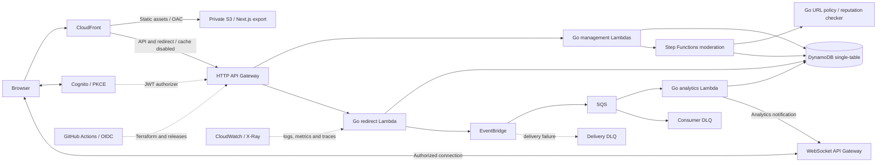

# Kế hoạch URL Shortener & Real-time Analytics Platform

Ngày lập: **25/10/2026**. Trạng thái: **Phase 02A hoàn tất offline; backend Phase 02B đã deploy và kiểm tra tại Sydney, CloudFront đang chờ AWS xác minh account**. Xem [kiểm tra offline](../docs/phase-02-verification.md) và [bằng chứng triển khai AWS](../docs/phase-02b-verification.md).

Mục tiêu: phát triển hệ thống có đăng nhập, quản lý link theo chủ sở hữu, redirect nhanh, analytics bất đồng bộ, dashboard realtime và moderation; hiểu và kiểm chứng từng bước trước khi mở rộng. Kế thừa MVP local hiện có, tiến tới AWS theo sáu phase ban đầu.

Đầu vào: [yêu cầu của project và kiến trúc hiện tại](../docs/architecture.md), [kết quả Phase 01](../docs/verification.md), ảnh stack do người dùng cung cấp, và [đối chiếu đủ 21 bài của series](../docs/series-review.md). Người dùng đã xóa tài nguyên AWS cũ và cho phép sửa MVP rồi triển khai Phase 02 local; domain dự kiến là `npt-shortenlink.dev`. Không tái sử dụng state/workflow triển khai cũ hoặc tạo AWS resources trong 02A.

## 1. Stack và phạm vi

| Thành phần                | Lựa chọn                                                                                        |
| ------------------------- | ----------------------------------------------------------------------------------------------- |
| Frontend                  | Next.js App Router, TypeScript, Tailwind CSS, shadcn/ui, pnpm; static export                    |
| Backend                   | Go, `aws-lambda-go`, AWS SDK for Go v2; native handlers gọi application use cases               |
| API                       | API Gateway HTTP API cho REST; API Gateway WebSocket cho realtime                               |
| Database                  | DynamoDB single-table, GSI, conditional writes, transactions; DynamoDB Local cho vòng lặp local |
| Hosting                   | S3 private + CloudFront OAC; API/redirect cache disabled                                        |
| Authentication            | Cognito, authorization code + PKCE, JWT authorizer, ownership trong application/storage         |
| Analytics                 | EventBridge → SQS + DLQ → Go aggregator → DynamoDB                                              |
| Moderation                | Step Functions Standard + Go checker + conditional state updates                                |
| Observability             | JSON logs, CloudWatch metrics/alarms, OpenTelemetry instrumentation → X-Ray                     |
| Infrastructure / delivery | Terraform; GitHub Actions CI, AWS OIDC CD, Lambda aliases + CodeDeploy canary/rollback          |

Không thêm ECS, EC2, RDS, backend web framework, runtime SSR, Server Actions hoặc Next.js API Routes. Không xây multi-region, billing, custom domains hay geo/device analytics trong lộ trình cơ bản này. Không mua dịch vụ hoặc dùng AWS credentials trong bước lập kế hoạch.

## 2. Kiến trúc đích

CloudFront phục vụ UI và chuyển `/api/*`, `/r/*` tới HTTP API. Chỉ rewrite route thư mục ở behavior dành cho static site, không rewrite các đường API. WebSocket dùng endpoint riêng. WAF là tùy chọn ở giai đoạn hardening, không mặc định coi đã có bảo vệ chỉ vì dùng CloudFront.

## 3. Giữ lại gì từ Phase 01

Đã có domain `Link`, create/get/list/resolve/enable use cases, repository port, DynamoDB adapter, HTTP local adapter, frontend và tests. Các file quan trọng:

- `services/lambda/internal/application/links.go`: giữ validation, code generation, collision handling, expiry; mở rộng actor và policy khi phase tương ứng cần.
- `services/lambda/internal/ports/links.go`: mở rộng các phương thức thực sự cần ownership/analytics; cập nhật tất cả adapters và test repositories cùng lúc.
- `services/lambda/internal/adapters/dynamostore/store.go`: giữ conditional puts và `METADATA`; thay collection index khi có user thật.
- `services/lambda/internal/localconfig/`: giữ local-only; không gỡ loopback guard hoặc dùng dummy credentials cho Lambda.
- `apps/web/src/lib/api.ts` và form/library: thêm auth, CRUD, analytics theo từng slice; bảo toàn static export.

Tạo Lambda transport và production SDK configuration riêng. Ban đầu dùng ba nhóm function: create, redirect, management; thêm consumer/WS/checker khi đến phase tương ứng. Không mặc định một function cho mọi endpoint hoặc tách mỗi use case thành một service độc lập.

Phase 01 đã được nghiệm thu ở lượt trước. Trong lượt lập kế hoạch này chỉ đọc mã và báo cáo cũ, không chạy lại để khẳng định một kết quả kiểm thử mới.

## 4. Các quyết định phải giữ xuyên suốt

| Quyết định                         | Hành vi và lý do                                                                                                                                                                                 |
| ---------------------------------- | ------------------------------------------------------------------------------------------------------------------------------------------------------------------------------------------------ |
| Redirect `302 + no-store`          | Link có thể bị disable, expire, sửa hoặc reject. Cache tại browser/CloudFront không được bỏ qua kiểm tra hoặc làm sai kỳ vọng analytics.                                                         |
| Native Go Lambda                   | Đề xuất `provided.al2023`, Linux/arm64 và ZIP `bootstrap`; test payload API Gateway v2. Build Windows phải bảo toàn executable permission trong ZIP.                                             |
| Actor từ hệ thống xác thực         | `ownerId` lấy từ Cognito `sub`, không nhận từ body/query. JWT hợp lệ chưa đồng nghĩa được truy cập link bất kỳ.                                                                                  |
| Ownership tại mọi đường dữ liệu    | Metadata và analytics cần kiểm chủ sở hữu; update/delete có condition tại DynamoDB. Cursor không cho client đổi owner partition.                                                                 |
| Scope rõ cho access token          | API dùng access token và authorization scopes; ID token dành cho thông tin đăng nhập.                                                                                                            |
| Collision khác request idempotency | Conditional put chống trùng code; không tự biến POST bị gửi lại thành cùng một operation. Chỉ thêm idempotency-key cho create nếu đưa vào acceptance riêng.                                      |
| Không giả lập auth trên cloud      | Phase 02 chưa có Cognito: management routes dùng AWS_IAM với quyền developer hẹp. Public browser management chỉ được mở sau Phase 03. UI cloud đầy đủ đến Phase 03; local MVP vẫn dùng loopback. |
| Data migration có chủ đích         | Không tự chuyển link local sang cloud hoặc tự gán link không có owner cho người dùng đầu tiên. Dùng table dev riêng; dữ liệu cũ chỉ được nhận owner khi có mapping được xác nhận.                |
| Delete không đổi chủ alias         | Đề xuất tombstone tối thiểu, xóa khỏi owner index, bỏ destination, không tái cấp code cũ. Late click events không được phục hồi metadata đã xóa.                                                 |
| Moderation tách enabled            | Redirect hợp lệ khi chưa xóa, enabled, chưa hết hạn và đã approved. Workflow không ghi đè lựa chọn disable của user.                                                                             |
| Logging không lộ dữ liệu           | Không log token, mật khẩu, ticket, URL query của destination hoặc IP thô theo mặc định. Không dùng code/user ID làm CloudWatch metric dimension có cardinality cao.                              |
| Không hứa zero cost                | Estimate theo region/account/workload; theo dõi tags, storage, logs, traces, queue requests và connection minutes. Budget cảnh báo không phải spending cap.                                      |

Các giới hạn dịch vụ và lựa chọn instrumentation đã được [đối chiếu tài liệu chính thức](../docs/series-review.md#các-điểm-đã-kiểm-lại-bằng-tài-liệu-chính-thức).

HTTP local và Lambda giữ application error envelope hiện tại. Lỗi do gateway sinh trước Lambda (401/403/429) có thể mang envelope riêng; OpenAPI và frontend cần xử lý cả hai, không hứa mọi lỗi AWS đều có cùng body.

## 5. Access patterns và dữ liệu dự kiến

Chỉ thêm từng loại item khi triển khai tính năng tương ứng. Giữ `SK=METADATA` hiện tại, không đổi sang `META` chỉ để giống bài viết.

| Nhu cầu                | Keys / cách truy cập                                                                           |
| ---------------------- | ---------------------------------------------------------------------------------------------- |
| Resolve theo code      | `PK=LINK#code`, `SK=METADATA`; strongly consistent GetItem                                     |
| Liệt kê link của actor | Metadata có `GSI1PK=USER#sub`, `GSI1SK=<fixed UTC timestamp>#code`; Query phân trang           |
| Sửa / xóa              | Metadata có `ownerId`, `version`; conditional update theo actor và version                     |
| Tổng click             | `PK=LINK#code`, `SK=ANALYTICS#TOTAL`                                                           |
| Click theo ngày UTC    | `PK=LINK#code`, `SK=STAT#YYYY-MM-DD`; Query từ ngày đến ngày, có giới hạn                      |
| Dedupe                 | `PK=EVENT#applicationEventId`, `SK=PROCESSED`, TTL epoch seconds                               |
| Connection realtime    | `PK=CONN#connectionId`, `SK=METADATA`; owner, code, session deadline; GSI prefix `WSCODE#code` |
| Ticket kết nối một lần | `PK=WSTICKET#randomTicket`, `SK=METADATA`; owner/code/session deadline; TTL ngắn               |

Analytics transaction ghi marker và tăng total/day trong cùng một lần atomic commit; kiểm metadata vẫn là link hợp lệ, không tạo lại link đã xóa. Dedupe TTL mặc định đề xuất **30 ngày tính từ khi xử lý**, đi cùng giới hạn retry/redrive tự động tối đa 30 ngày. Replay cũ hơn cần một quy trình rebuild/reconciliation riêng; TTL 30 ngày không tạo bảo đảm vô hạn. Retention của analytics và tombstone cần được ghi vào runbook trước production.

Không bật TTL cho link để thay thế kiểm expiration. GSI và TTL đều có độ trễ; ứng dụng phải kiểm điều kiện nghiệp vụ ngay khi sử dụng.

## 6. Hợp đồng analytics và lỗi

Event `link.clicked.v1` có `eventId` tối thiểu 128 bit ngẫu nhiên mật mã do producer tạo một lần, `code`, `ownerId` lấy từ metadata, `occurredAt` UTC và `schemaVersion`. SDK retries dùng cùng application event ID. Không lấy SQS message ID làm khóa dedupe.

Đề xuất mặc định **ưu tiên redirect**: Lambda chờ publish với timeout/retry có giới hạn, kiểm cả lỗi entry; nếu publish thất bại vẫn trả redirect và ghi metric/structured error. Không chạy goroutine publish sau khi handler đã trả response. Đánh đổi: có thể thiếu click trước lúc event được chấp nhận; SQS/DLQ không bù được lỗi ở producer. Nếu yêu cầu không mất bất kỳ accepted redirect nào, phải đổi quyết định này trước Phase 04, thiết kế durable outbox và tính lại latency/chi phí.

Consumer chỉ ACK duplicate khi xác nhận conditional failure ở dedupe marker. Conflict/throttle/lỗi lưu trữ đi vào retry; malformed event đi qua chính sách retry rồi DLQ. EventBridge target-delivery DLQ và consumer poison-message DLQ bảo vệ hai chặng khác nhau. Redrive giữ nguyên application event ID.

Click được định nghĩa là **GET redirect đã được ghi nhận**, không phải unique human visitor. HEAD không tăng click; bot/prefetch vẫn có thể tạo GET. Dashboard thể hiện analytics eventual consistency và trạng thái kết nối.

## 7. Roadmap và điều kiện hoàn thành

Checklist chi tiết, dependency, file dự kiến và cách nghiệm thu nằm trong [todo.md](todo.md). Mỗi task là một thay đổi có thể review; không triển khai cả phase trong một lần không có checkpoint.

| Phase                           | Liên hệ series    | Sản phẩm bàn giao / exit gate                                                                                                                       |
| ------------------------------- | ----------------- | --------------------------------------------------------------------------------------------------------------------------------------------------- |
| **01 — Local MVP**              | 01–07, phần local | Đã có; giữ xanh bộ test và static export khi mở rộng.                                                                                               |
| **02A — Cloud-ready offline**   | 02–07, 14, 17–18  | Native Lambda adapters, artifact build, Terraform validate, IAM/CORS/logging/throttle và CI; chưa apply.                                            |
| **02B — AWS dev core**          | 02–07             | Chỉ khi người dùng yêu cầu triển khai: state backend, dev infra, S3/OAC/CloudFront, API/Lambda/DynamoDB; smoke test có xác thực IAM cho management. |
| **03 — Auth & link management** | 08–09             | Cognito + frontend login/session; hai user không đọc/sửa/xóa được dữ liệu nhau; edit/disable/expire/delete hoạt động từ UI.                         |
| **04 — Event-driven analytics** | 10–11             | EventBridge/SQS/transactional aggregator, total/day API + chart; duplicate đúng một lần trong retention contract; retry/DLQ/redrive được diễn tập.  |
| **05A — Realtime**              | 12                | Ticket và connection có ownership, thông báo WebSocket, reconnect/snapshot; không leak analytics giữa user.                                         |
| **05B — Moderation**            | 13                | Create/edit → pending → approved/rejected/error; version guard; URL chưa approved không redirect.                                                   |
| **06 — Production readiness**   | 14–21             | OIDC CD, canary và rollback thật, runbooks, SLO/alarms, load/cost/recovery và hardening review.                                                     |

Baseline logging/IAM/CI thực hiện từ Phase 02; Phase 06 hoàn thiện vận hành, không phải lúc đầu tiên thêm chúng.

## 8. Realtime và moderation: giới hạn cần thiết kế trước

**Realtime:** REST endpoint được JWT bảo vệ cấp ticket ngắn hạn, dùng một lần, gắn actor và code đã kiểm ownership. WebSocket `$connect` kiểm ticket bằng Lambda authorizer; không đặt JWT dài hạn trong query string. Connection hết session phải được chặn hoặc đóng dù TTL chưa xóa item. Nếu có route subscribe, route đó kiểm ownership lại. Lỗi gửi 410 dọn connection; lỗi khác có metric. Push thông báo `analytics.updated`, client tải lại snapshot có auth và debounce để không query mỗi message khi tải tăng. Reconnect luôn lấy snapshot, không giả định nhận đủ mọi push.

**Moderation:** checker không tự fetch destination. Giai đoạn đầu có thể dùng policy allow/deny đã ghi rõ; không gắn nhãn “malware-safe” chỉ vì không có từ khóa bị cấm. Chọn reputation provider và điều khoản/chi phí trước khi tích hợp quét thật. Create/edit ghi pending rồi khởi chạy workflow với identity theo code/version. Start thất bại giữ trạng thái không redirect, báo lỗi quan sát được và cho owner retry; execution retry không tạo approval kép. Kết quả workflow cập nhật có điều kiện version, không phục hồi link đã xóa hoặc reset enabled. Không cần xây saga khi workflow chưa có side effects cần compensation.

## 9. Infrastructure, release và production gates

- Đề xuất region dev `ap-southeast-1`; xác nhận region/account trước khi triển khai. Ban đầu dùng domain CloudFront được cấp, không mua domain.
- Terraform bắt đầu với root dev chia file theo thành phần; tách module khi có nhu cầu reuse thực tế. State bucket có mã hóa, versioning, quyền hẹp và S3 state lock; backend bootstrap là bước riêng, không tự xóa cùng application stack.
- S3 OAC dùng REST origin private; route `/dashboard/` cần CloudFront Function rewrite tới `/dashboard/index.html`. Không dùng SPA fallback cho mọi 403/404 để che lỗi API hoặc missing assets.
- CI pull request không có AWS credentials: format/test/build, DynamoDB Local, browser integration, Terraform fmt/init backend-disabled/validate. Backend init có thể tải provider từ registry, không được gọi tài khoản AWS.
- OIDC deployment role ràng buộc đúng repository và environment; PR không tin cậy không được assume deploy role. Infrastructure plan được review; production environment và concurrent deployment được kiểm soát.
- API Gateway integration trỏ **Lambda alias**, không gọi `$LATEST`. CodeDeploy dịch traffic giữa published versions. Terraform quản lý tài nguyên; CodeDeploy quản lý routing alias khi rollout. Ghi rõ ownership của alias/version/routing để lần Terraform apply tiếp theo không reset canary hoặc bản rollback.
- Chỉ gọi là rollback đã kiểm chứng sau khi deliberately failing release làm alarm/hook kích rollback và alias quay về bản tốt. Với tải thấp phải có synthetic checks, không chờ traffic tự nhiên.
- Frontend dùng versioned assets; upload assets trước HTML, cache HTML ngắn, giữ asset của release cũ trong cửa sổ rollback. Rollback backend cần schema/event compatibility với frontend cũ.
- Nếu bật WAF, áp cho traffic API/redirect qua CloudFront và chặn bypass qua execute-api/custom origin bằng origin gate đã kiểm chứng. Không nghiệm thu WAF protection khi còn đường gọi thẳng bỏ qua nó. S3 OAC chỉ bảo vệ S3, không tự bảo vệ API origin.

Các thao tác plan/apply/deploy/destroy dùng AWS chỉ được thực hiện khi có yêu cầu tương ứng. Không nhúng credentials hoặc tạo lệnh destroy tự động trong bước nghiên cứu này.

## 10. Quality bar đề xuất

| Mặt kiểm tra  | Điều kiện nghiệm thu                                                                                                                                    |
| ------------- | ------------------------------------------------------------------------------------------------------------------------------------------------------- |
| Functional    | Toàn bộ local tests giữ xanh; contract giữa local HTTP và Lambda tương đương; browser create/manage/redirect hoạt động                                  |
| Authorization | Thiếu/sai/hết hạn token bị chặn; A không đọc/sửa/xóa/xem stats/subscribe của B; public redirect vẫn mở được                                             |
| Events        | N unique events → N increments; duplicate không cộng; conflict/throttle không bị ACK nhầm; failed batch chỉ retry message lỗi                           |
| Moderation    | Pending/rejected/error không redirect; stale approval không vượt version hoặc enabled/deleted guard                                                     |
| Availability  | Mục tiêu khởi điểm 99,9% cho request hợp lệ trong nominal capacity; định nghĩa denominator và exclusions trước khi đo                                   |
| Latency       | Mục tiêu thử nghiệm warm redirect p95 dưới 200 ms và analytics visible p95 dưới 5 s trong dev load đã thống nhất; cold-start và overhead quan sát riêng |
| Operations    | Alarm + runbook cho 5xx/throttle, publish failure, queue age/DLQ và workflow failure; restore và rollback có bằng chứng                                 |
| Cost          | Estimate theo workload và giá hiện hành; log retention/tracing sampling; không mặc định NAT/VPC, provisioned concurrency hoặc multi-region              |

Đây là **mục tiêu cần đo**, chưa phải khả năng đã chứng minh của project. Load target phải dựa trên quota thật của tài khoản và ngân sách đã thống nhất; không lấy concurrency 10 hay benchmark của tác giả làm thông số của mình.

## 11. Trình tự làm việc tiếp theo

1. Review tài liệu này và checklist; bắt đầu bằng **02.1 — native Lambda transport và artifact** khi có yêu cầu triển khai tiếp.
2. Hoàn thành 02A bằng kiểm tra offline; bàn giao diff, artifact và Terraform definitions để review.
3. Dừng trước 02B cho tới khi có yêu cầu dùng AWS. Không tự đọc credentials, provision hoặc deploy.
4. Mỗi phase sau có checkpoint riêng; tiếp tục theo mục tiêu người dùng giao, không tự chạy hết roadmap.

Trước từng phase cần chốt: region/account/budget ở 02B; token/session settings ở 03; mức bảo đảm mất click và replay horizon ở 04; reputation provider ở 05B; tải mục tiêu, retention, SLO và phương thức cảnh báo ở 06. Các lựa chọn chưa cần cho bước hiện tại không chặn việc review roadmap.
